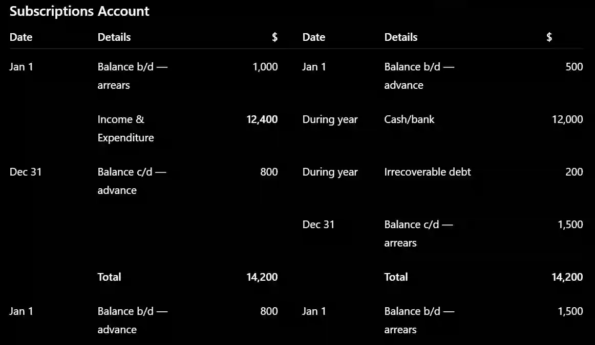

## Subscriptions account

* A subscriptions account calculates the **amount of subscriptions relating to the current financial year**.

* This amount is then transferred to the income and expenditure account.

Subscriptions can involve:

**Subscriptions in arrears**

* These are amounts owed by members: They are an **asset** because the club is entitled to receive the money.

**Subscriptions paid in advance**

* These are amounts received for a future period: They are a **liability** because the club still has to provide services to the members.

### Subscription formula

A useful way to calculate subscriptions income is:

$$ \text{Subscriptions for year} = \text{Subscriptions received} - \text{Opening arrears} + \text{Opening prepayments} + \text{Closing arrears} - \text{Closing prepayments} $$

The key idea is that the income and expenditure account records the subscriptions **belonging to the current year**, not simply the amount of cash received

### 
Worked Example: 

A club has the following information for the year ended **31 December 2025**:

* Subscriptions in arrears at 1 Jan 2025 = **$1,000**

* Subscriptions in advance at 1 Jan 2025 = **$500**

* Subscriptions received during the year = **$12,000**

* Irrecoverable subscriptions = **$200**

* Subscriptions in arrears at 31 Dec 2025 = **$1,500**

* Subscriptions in advance at 31 Dec 2025 = **$800**

  
  