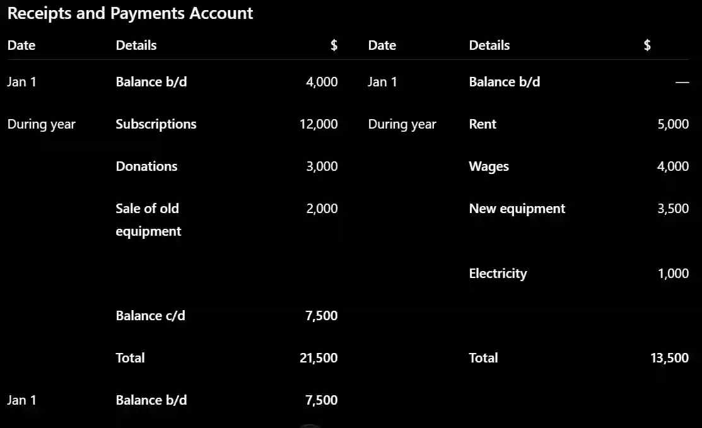

## Receipts and payments account

* The receipts and payments account is essentially a **summary cash book** for a club or society.

It records all money received and all money paid during the year.

* **Receipts are recorded on the debit side.**

* **Payments are recorded on the credit side.**

#|
||

Receipts

|

Payments

||
||

Subscription Received

|

Wages

||
||

Shop Sale

|

General Expense

||
||

Rental Income

|

Utility Costs

||
||

Donations

|

Purchase of inventory

||
||

Grants

|

Purchase of non current assets

||
|#

The closing balance represents the **cash or bank balance** at the end of the year.

**Worked Example:** 

**A sports club has the following information for the year ended 31 December 2025:**

* Cash/bank balance at 1 January: **$4,000**

* Subscriptions received: **$12,000**

* Donations received: **$3,000**

* Sale of old equipment: **$2,000**

* Rent paid: **$5,000**

* Wages paid: **$4,000**

* Purchase of new equipment: **$3,500**

* Electricity paid: **$1,000**

