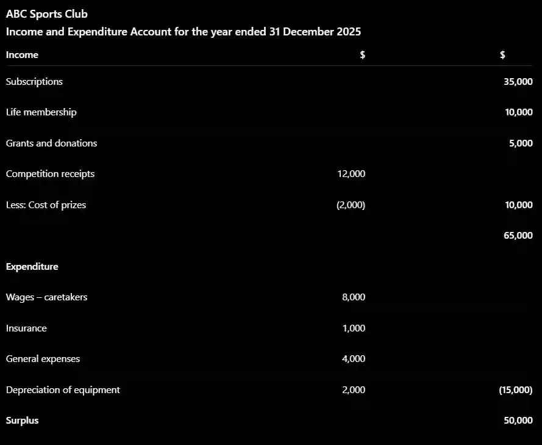

## Income and expenditure account

* The income and expenditure account calculates the **surplus or deficit for the year**.

It is similar to a statement of profit or loss, but it is prepared for a non-trading organization.

$$ \text{Surplus} = \text{Income} - \text{Expenditure} $$

* If income is greater than expenditure, there is a **surplus**.

* If expenditure is greater than income, there is a **deficit**.

Only income and expenditure are included. **Assets and liabilities are not included** in this account.

examples:

#|
||

Income

|

Expenditure

||
||

Trading income (Sales Revenue

|

Direct costs (purchases, carriage inwards)

||
||

Non profit income (membership free and donations)

|

Operating expense (Shope rent, wage)

||
||

Other operating income (rent received, commission received)

|

Financial expense (discount allowed, bad debts)

||
||

Financial Income (Interest Received, Profit on sale of non-current asset)

|

Capital expenditure (Buying machine)

||
|#

Adjustments may be required for:

* Depreciation

* Accruals

* Prepayments

* Subscriptions written off

* Life membership income

* Deferred income

* Profits or losses from trading activities

### Income and expenditure adjustments

For **accruals**:

$$ \text{Current year expense} = \text{Amount paid} - \text{Opening accrual} + \text{Closing accrual} $$

For **prepayments**:

$$ \text{Current year expense} = \text{Amount paid} + \text{Opening prepayment} - \text{Closing prepayment} $$

The objective is always to calculate the amount that **belongs to the current accounting year**, rather than simply using the cash received or paid

Worked Example — Income and Expenditure Account

**ABC Sports Club** provides the following information for the year ended **31 December 2025**:

* Subscriptions = **$35,000**

* Life membership fees = **$10,000**

* Grants and donations = **$5,000**

* Competition receipts = **$12,000**

* Cost of prizes = **$2,000**

* Wages – caretakers = **$8,000**

* Insurance = **$1,000**

* General expenses = **$4,000**

* Depreciation of equipment = **$2,000**

  