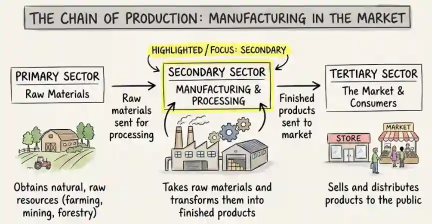

# Manufacturing Businesses

A manufacturing business **makes the goods that it sells**. It purchases raw materials and converts them into finished goods.

Manufacturing businesses can be:

* Sole traders

* Partnerships

* Limited companies

A manufacturer may also purchase finished goods for resale in addition to producing its own goods. This allows it to offer more products, but purchased goods may be more expensive and their quality cannot be controlled by the business.

## Financial statements

A manufacturing business prepares:

* **Manufacturing account**: calculates the cost of producing the goods.

* **Statement of profit or loss**: calculates the profit or loss from selling the goods.

* **Statement of financial position**: shows the financial position of the business.