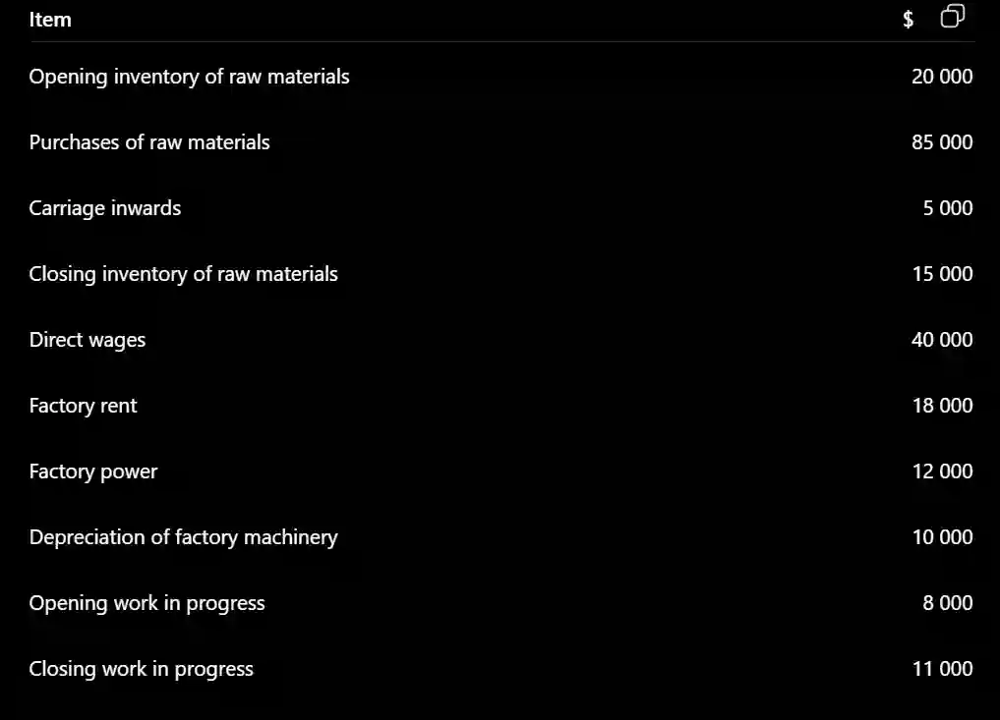

## Preparation of Manufacturing Accounts

### Worked Example

A manufacturing business provides the following information for the year ended 31 December 2025:

Answer :

#|
||

**Cost of materials consumed**

|

$

|

$

||
||

Opening inventory of raw material

|

20000

|

ㅤ

||
||

Purchases of raw materials

|

85000

|

ㅤ

||
||

Carriage Inwards

|

5000

|

ㅤ

||
||

ㅤ

|

ㅤ

|

110000

||
||

Less: Closing inventory of raw materials

|

ㅤ

|

(15000)

||
||

ㅤ

|

ㅤ

|

95000

||
||

Direct Wages

|

ㅤ

|

40000

||
||

Prime cost

|

ㅤ

|

135000

||
||

ㅤ

|

ㅤ

|

ㅤ

||
||

**Factory Overheads**

|

ㅤ

|

ㅤ

||
||

Factory rent

|

18000

|

ㅤ

||
||

Factory Power

|

12000

|

ㅤ

||
||

Depreciation of factory machinery

|

10000

|

ㅤ

||
||

Total Factory overheads

|

ㅤ

|

40000

||
||

ㅤ

|

ㅤ

|

175000

||
||

Add: Opening work in progress

|

ㅤ

|

8000

||
||

ㅤ

|

ㅤ

|

183000

||
||

Less: Closing working in progress

|

ㅤ

|

(11000)

||
||

Cost of production

|

ㅤ

|

172000

||
|#

