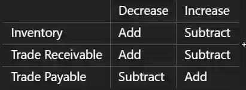

#|
||

ㅤ

|

Description

||
||

**Cash flows from operating activities**

|

Start with profit from operations, which is profit before loan interest and tax.

Adjust for:

* Depreciation

* Loss on disposal of non current assets

* Profit on disposal of non current assets

* Changes in working capital

* Interest actually paid

* Tax actually paid

This gives the net cash from or used in operating activities

||
||

**Changes in working capital**

|

||
||

**Cash flows from investing activities**

|

Investing activities involve non current assets.

* Sale of non current assets → cash inflow

* Purchase of non current assets → cash outflow

$$ \text{Net Cash from Investing Activities} = \text{Sale Proceeds} - \text{Purchase of Non-Current Assets} $$

It is usually cash used in investing activities.

||
||

**Cash flows from financing activities**

|

Financing activities involve raising or repaying finance.

Cash inflows include:

* Issue of share capital

* New loans or debentures

Cash outflows include:

* Repayment of loans or debentures

* Dividends paid

||
||

**Calculating profit from operations**

|

If profit for the year is given:

$$ \text{Profit from Operations} = \text{Profit for the Year} + \text{Finance Costs} + \text{Taxation} $$

* The amounts due for interest and tax are used when calculating profit from operations.

* The amounts actually paid are used in operating cash flows.

||
|#

### **Important cash flow adjustments**

* Depreciation is added back because it is a non cash expense.

* A loss on disposal is added because it reduced accounting profit but did not represent an operating cash outflow.

* A profit on disposal is subtracted because it increased accounting profit but is not an operating cash inflow.

* A bonus issue is excluded because it raises no cash.

* A rights issue is included under financing activities because it raises cash.