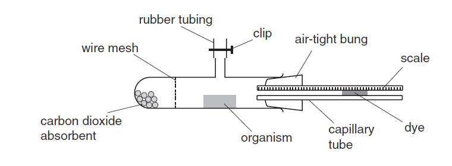

## To investigate the respiration rates of small invertebrates and germinating seeds using respirometer

  - Measure mass of invertebrates and germinating seedling

  - Use seedlings before plumule emerged

  - Dye at capillary tube farthest from tube

  - Keep Airtight using the air-tight bung

  - Keep temperature constant

  - Allow organism to adjust for a given period of time

  - Close clip before taking measurements

  - Measure distance moved by dye for standard amount of time

  - Repeat experiment at least 3 times

  - Replace carbon dioxide absorbent (e.g. Soda lime) between
    measurements

  - Calculate volume by measuring diameter capillary and multiplying by
    the length/distance moved
