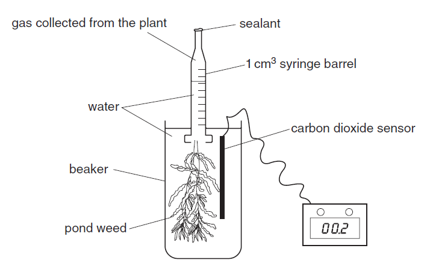

## To investigate the effects of carbon dioxide concentration on the rate of photosynthesis

  - Use hydrogen carbonate to provide carbon dioxide

  - Make at least 5 different concentration of carbon dioxide

  - Measure concentration of carbon dioxide with a probe

  - Measure the time taken to collect a known volume of gas

  - Use same mass/length/same piece/same number of leaves/same species
    of pondweed

  - Keep light at a fixed distance from plant (light intensity)

  - Use thermostatically controlled water bath

  - Use same volume of water (measuring cylinder, burette)

  - Carry out experiment in a dark room (eliminate any other light
    source)

  - Use 3 sets of measurements per experiment and take mean

  - Low risk experiment (electric shocks faulty equipment/wet wiring)