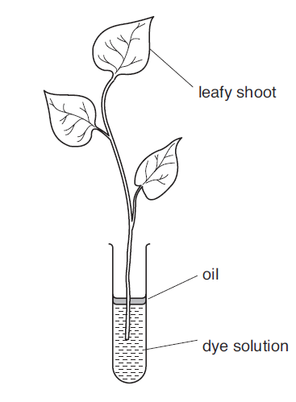

## To investigate transpiration in plants

 

* Observe dye through stem, at known time interval and known distance;
  record time for dye to reach it
* Use Vernier callipers to measure stem and ruler in cm/mm
* Use several shoots/sequential measurements on the same shoot
* Cut under water/dye to avoid air from entering
* Keep temperature constant e.g., temperature-controlled room
* Carry out experiment in a dark room with light at fixed illumination
* Keep light at a fixed distance
* Provide steady air flow using a fan set at constant speed
* Repeat experiment for at least 3 times and take mean
* Low risk experiment: dye can be toxic, wear gloves

