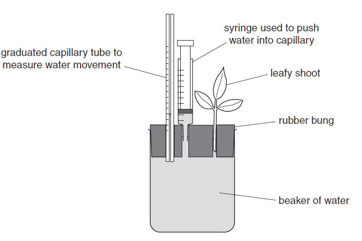

## To investigate the transpiration rates of two different plants using a potometer

  - Use shoots/leaves of different types of plant used

  - Keep surface area of shoots/leaves same

  - Measure/record the movement (of water) along the capillary

  - Measure time of water movement for a fixed amount of distance using
    stopwatch

  - Keep light intensity, temperature, and humidity same

  - Carry out experiment in a dark room with light of fixed illumination

  - Keep temperature constant e.g. temperature-controlled room

  - Insert shoot under water/cut shoot at an angle

  - Dry the leaves before measuring mass

  - Keep airtight using an airtight apparatus/rubber bang

  - Use a syringe to set water level in capillary

  - Leave until equilibrium reached

  - Repeat experiment for at least 3 times and take mean