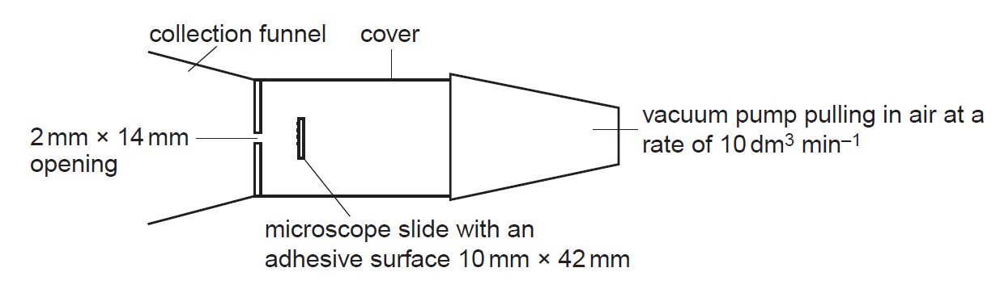

## To investigate if there are more pollen grains in the atmosphere during the day or night

  - Expose slide/apparatus for a known period of time in different light

  - Use intensities ranging from dark (zero intensity) to light and dark
    conditions

  - Count pollen in the field of view

  - Count at least 3 areas of the slide

  - Measure the diameter of field of view using the eyepiece graticule

  - Calculate area of field of view using formula *π*r2

  - Take all readings from the same location

  - Remove any pollen on opening between each slide

  - Carry out experiment in an outside location

  - Make sure there are no walls/hedges/trees in the way

  - Repeat the whole investigation on 3 different days and taking mean

  - safety: use mask in case of pollen allergy

  - Low risk investigation