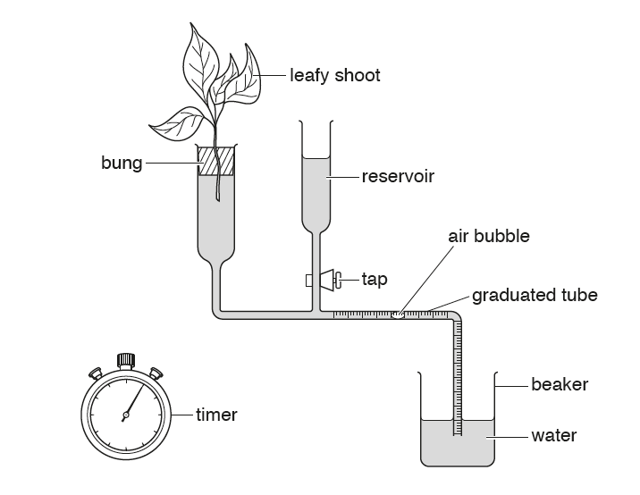

## To investigate the rate of transpiration at different light intensities using a potometer

  - Cut/insert stem of plant under water

  - Use petroleum jelly/silicone to make joints air-tight

  - Remove tube from water to introduce an air bubble

  - Obtain a minimum of 5 different light intensities; keep lamp at a
    fixed distance and use filters of different strengths/thickness

  - Allow apparatus/plant to equilibrate before starting measurements

  - Reset air bubble to start position between measurements

  - Measure distance moved by bubble over a set time using the graduated
    pipette OR Measure time taken for bubble to move a set distance
    using a stopwatch

  - Take a minimum of 2 repeats at each light intensity and calculate
    mean/identify anomalies

  - Low/medium risk investigation: Cut stem and cut away from your hand
    with scalpel

  - Keep temperature constant by carrying out experiment in a
    temperature-controlled room

  - Carry out experiment in a dark room, no external light source should
    be present

  - Use same lamp to ensure same wavelength/brightness/colour of light

  - Keep airflow constant by turning fan off or on at the same speed

  - Use same species if plant’s leaves/shoot

  - Use a humidifier to keep humidity the same