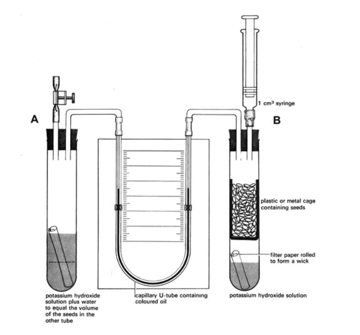

## To calculate respiratory quotient by conducting an experiment

  - Pour known volumes of potassium hydroxide to each respirometer
    vessel

  - Add filter paper to act as wicks

  - Add known volume of seeds in one of the vessels, make sure the
    seeds/invertebrates do not meet potassium hydroxide, keep seeds in a
    box

  - Add same volume of water in the other vessel

  - Fit bungs in both vessels

  - Attach two connecting tubes to vessel with water, one with a clip on
    a flexible hose

  - Attach a syringe of known volume and a connecting tube to vessel
    with seeds/invertebrates

  - Add dye/coloured liquid to U-shaped manometer

  - Connect manometer to the connecting tubes

  - Make sure that the apparatus is airtight

  - Use the syringe (by pressurizing and releasing pressure) to adjust
    the manometer so that the fluid levels is same on both side

  - Record position of syringe, position of both sides of meniscus and
    the time

  - Record new positions of manometer fluid at regular intervals. When
    it reaches the end of one side of the tube, restore original
    position and record readings on syringe

  - Find volume of oxygen absorbed by seeds/invertebrates in a known
    period. This is Vol1

  - Remove potassium hydroxide from both vessels and wash them out with
    water

  - Replace seeds/invertebrates with equal volume of water and record
    changes in gas volume for known period. This is Vol2

  - Calculate volume of CO2 produced

  - Calculate respiratory quotient using formula

$$Respiration\ Quotent = \frac{\text{Volume\ of\ carbon\ dioxide\ produced}}{\text{Volume\ of\ oxygen\ absorbed}}$$

$$RQ = \frac{Vol1 + Vol2}{Vol1}$$
