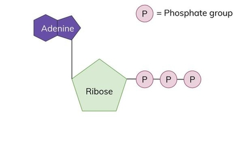
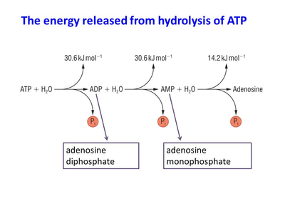

# Energy and Respiration

## ATP: Adenosine Triphosphate

* ATP is a molecule that captures chemical energy made from respiration, and releases it to supply other cellular processes

### Characteristics:

* Used as energy currency, linking energy-requiring and energy-giving reactions the same way money links a customer and a seller

* Hydrolyses easily to release the energy it stores

* It is small and soluble so it can easily be transported around the cell and hydrolyzed wherever necessary

* Stable in cell pH

* Requires **ATPase** to break down

* Releases just the right amount of energy so that none goes to waste

* Has a high turnover rate, meaning it is quickly formed and used

### Structure:

* ATP is a nucleotide, meaning it has a sugar, base and phosphate

* Adenine is the nitrogenous base, ribose is the pentose sugar, with 3 phosphate groups attached

### Hydrolysis of ATP

* Occurs with the addition of H₂O, assisted by enzyme ATPase

* ATP hydrolyses into ADP, then AMP, and lastly adenosine

* Releases energy

* Excess energy is lost as heat energy during hydrolysis

### Synthesis of ATP:

Cells have to make ATP constantly, because they cannot build up large stores of it

ATP is made in two ways, during aerobic respiration

1. **Substrate-linked phosphorylation:** ATP is made from ADP and phosphate group, without an electron transport chain, using the energy provided by another chemical reaction (Glycolysis and Krebs Cycle)

2. **Chemiosmosis:** ATP is made using energy released from movement of protons across a membrane, in an electron transport chain (Oxidative phosphorylation)