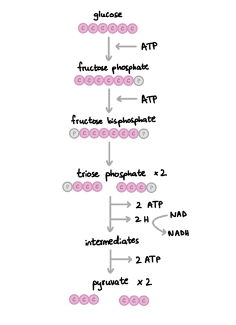
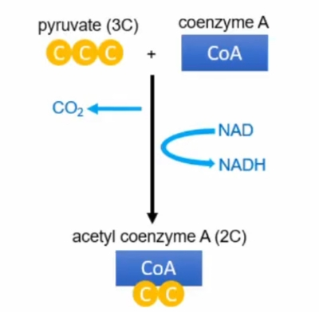
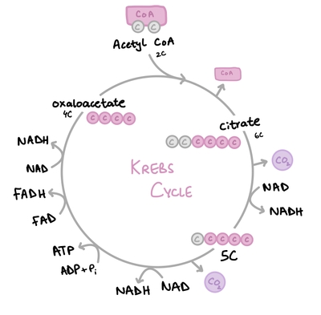
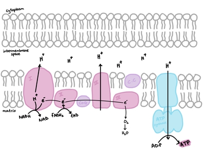

## Aerobic Respiration

* The process where organic molecules are broken down to release energy in the form of ATP

* C₆H₁₂O₆ + 6O₂ → 6CO₂ + 6H₂O + 2780 kJ

* Takes place in 4 stages:

1. **Glycolysis** - in cytoplasm

2. **Link Reaction** - in mitochondrial matrix

3. **Krebs Cycle** - in mitochondrial matrix

4. **Oxidative Phosphorylation** - cristae

### Stage 1: Glycolysis

1. Glucose is phosphorylated to form fructose phosphate then fructose bisphosphate, using 2 ATP, providing activation energy for splitting of glucose

2. Fructose bisphosphate breaks down to 2x triose phosphate

3. 2 hydrogen atoms are removed, which are taken up by 2 NAD molecules that become NADH (reduced NAD), releasing 2x ATP

4. After dehydrogenation, an intermediate is formed

5. Then, 2x pyruvate molecules are formed from the intermediate, releasing 2x more ATP

* 4 ATP made – 2 ATP used = Net 2 ATP formed

* NADH is transported to the ETC to give its hydrogen atoms up

* Pyruvate enters the link reaction

**NAD (Nicotinamide Adenine Dinucleotide):** A coenzyme that carries hydrogen from stages 1, 2 and 3 to the ETC

* NAD + H → NADH

**FAD (Flavin Adenine Dinucleotide):** Coenzyme that also carries hydrogen from only stage 3 to the ETC

* FAD + 2H → FADH₂

### Stage 2: Link Reaction

1. Pyruvate is transported from cytoplasm into mitochondrial matrix by active transport

2. When oxygen is available, pyruvate is decarboxylated, dehydrogenated, and combined with coenzyme A to form acetyl coenzyme A, releasing 1 molecule of CO₂. Since there are 2 pyruvate molecules, this process repeats twice to form 2x CO₂.

3. Dehydrogenation results in NAD⁺ gaining **2 electrons and 1 proton** to form **1** **reduced NAD** **(NADH).** The process is repeated twice per glucose molecule to produce 2x NADH molecules.

### Stage 3: Krebs Cycle

1. Acetyl CoA combines with oxaloacetate to form citrate

2. Citrate is decarboxylated and dehydrogenated in a series of steps

3. Oxaloacetate is regenerated at the end of the circular pathway, to combine with another acetyl CoA and repeat the cycle

* Products: 6 NADH, 2 FADH₂, 2 ATP, 4 CO₂ per molecule of glucose

### Stage 4: Oxidative Phosphorylation

1. NADH and FADH₂ bind to the complexes and give hydrogen atoms. NADH → NAD⁺ + H ; FADH₂ → FAD + 2H

2. Hydrogen atoms split into electrons and protons (H⁺ ions). H → H⁺ + e⁻

3. The electrons are passed from carrier to carrier along the ETC, releasing energy at each step

4. The complexes are energized from the electron transfer, and this energy is used to actively transport protons into the intermembrane space

5. An electrochemical gradient develops due to the difference in H⁺ concentration

6. The protons move back down the gradient into the matrix, but through ATP synthase by facilitated diffusion, producing ATP

7. Oxygen is the final electron acceptor: ½O₂ + 2H⁺ + 2e⁻ → H₂O

8. For every 3 H⁺ ions diffusing through ATP synthase, 1 ATP is formed: ADP + Pi → ATP (chemiosmosis)

* ATP synthase is a transporter protein + enzyme

* Total 28 ATP is made

* In aerobic respiration as a whole, 34 ATP are made (net 32)

#|
||

Stage

|

ATP used

|

ATP made

|

Net gain in ATP

||
||

Glycolysis

|

2

|

4

|

2

||
||

Link reaction

|

0

|

0

|

0

||
||

Krebs cycle

|

0

|

2

|

2

||
||

Oxidative phosphorylation

|

0

|

28

|

28

||
||

Total

|

2

|

34

|

32

||
|#

