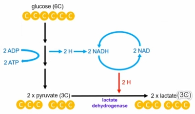
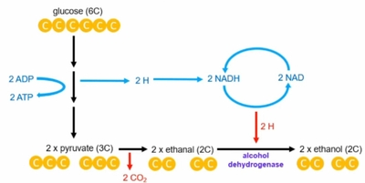

## Anaerobic Respiration

* Incomplete breakdown of glucose to synthesize ATP in the absence of oxygen

* Occurs in the cytoplasm

* Produces net 2 ATP per glucose molecule

* Without oxygen, there is no final electron and H⁺ ion acceptor, so the ETC stops working

* Hydrogen cannot be removed from NADH and FADH₂ so stages 2 and 3 also stop because they rely on NAD and FAD regeneration

* However, glycolysis still occurs, and NAD is regenerated through alternative pathways

### Lactate Fermentation:

* Occurs in animals

1. Glycolysis occurs and pyruvate is formed

2. Pyruvate is reduced to **lactate** (lactic acid) by the enzyme **lactate dehydrogenase**

3. NADH is oxidized to NAD⁺ which is needed for glycolysis to continue

* Lactate is toxic and causes muscle fatigue

* It’s transported to the liver to either be converted to glycogen and stored, or broken down into pyruvate which enters the Krebs Cycle

* The conversion of lactate to glycogen or pyruvate requires extra oxygen, so an oxygen debt builds up

* **EPOC** (**E**xcess **P**ost-exercise **O**xygen **C**onsumption) helps the body repay the oxygen debt incurred

### Ethanol Fermentation:

* Occurs in plants and microorganisms

* Produces ethanol and CO₂

1. Glycolysis occurs and pyruvate is formed

2. Pyruvate is decarboxylated to **ethanal**

3. Ethanal is reduced to **ethanol** by the enzyme **alcohol dehydrogenase**

4. NADH is oxidized back to NAD⁺ so that glycolysis can continue

* Ethanol is also toxic, but it cannot be further metabolized so it is a waste product

### Difference between lactate and ethanol fermentation:

1. **Enzymes used:** Lactate dehydrogenase in lactate pathway, alcohol dehydrogenase in ethanol pathway

2. **Reversibility:** Lactate fermentation is reversible, ethanol fermentation is not

3. **CO2 production:** CO2 is only produced in ethanol fermentation

4. **Intermediate:** Only ethanol fermentation has an intermediate, which is acetaldehyde/ethanal