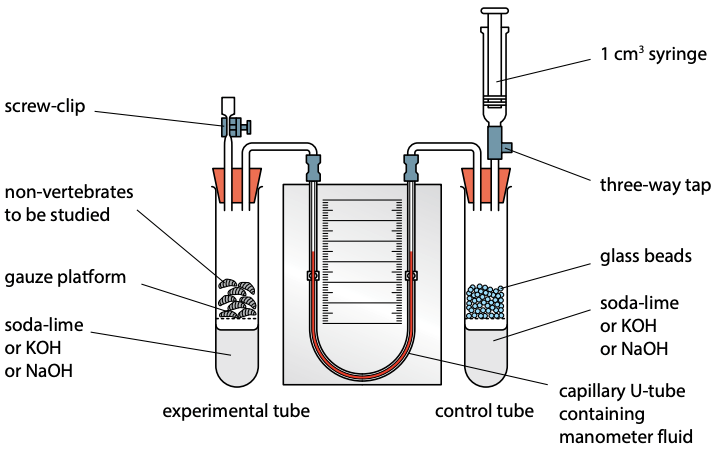

## Respirometer

- Measures oxygen uptake in a sealed container for respiring organisms
  e.g germinating seeds or invertebrate organism

- CO2 produced is absorbed by soda lime/concentrated KOH or
  NaOH.

- The decrease in the volume of air results from their oxygen
  consumption and rises the manometer fluid in the tube.

- Oxygen consumption per unit time can be measured by reading the
  level of the manometer fluid against a scale.

- Temperature must be kept constant via thermostatically controlled
  water bath.

- A control tube helps maintain pressure – it contains equal volume of
  inert material as the volume used in the experimental tube so that
  any changes in atmospheric pressure can be compensated for

- Finally, a graph of oxygen consumption against temperature can be
  plotted.

- **Note:** this apparatus can also be used to measure RQ where $x$
  is the oxygen consumption, $y$ is the increase of volume of air
  due to CO2 production (fluid falls), and $z$ is the
  decrease in volume of air when more O2 is consumed than
  CO2 produced (fluid rises)

- Manometer fluid stays constant when O2 consumption and
  CO2 production are equal (RQ=1)