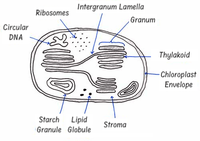

# Photosynthesis

## Photosynthesis

* Photosynthesis is the opposite process of respiration

* $6CO_2 + 6H_2O → C_6H_12O_6 + 6O_2$

* There are two major reactions, the light dependent stage and the light independent stage

### Chloroplasts

* Appear as biconvex discs, about 3-10 µm

* Surrounded by two smooth membranes forming an envelope

**Stroma:**

* It is the watery material inside the envelope

* Contains 70S ribosomes, circular DNA, starch grains, lipid droplets and enzymes

* The DNA codes for proteins e.g. rubisco enzyme

**Internal membranes:**

* There are more membranes inside called **lamellae**, which are arranged to form fluid-filled sacs called **thylakoids**

* The membranes that form the sacs are thylakoid membranes, while the spaces inside the sacs are thylakoid spaces

* The lamellae and thylakoids contain photosynthetic pigments, and carrier molecules that work as an ETC

* Thylakoids stack up to form **grana**, which increase surface area for photosynthesis

* The LDS occurs in thylakoids, while the LIDS occurs in stroma