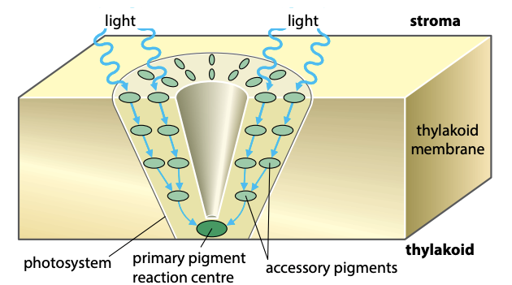
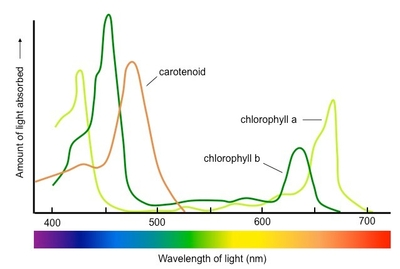
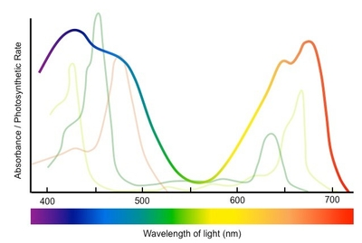

## Photosynthetic Pigments and Photosystems

* Colored substances that absorb light of particular wavelengths for photosynthesis

* Found on thylakoid membranes

* Different pigments absorb different wavelengths of light, and reflect back the wavelengths they don’t absorb

  * For example, chlorophyll looks green because it absorbs red & blue light and reflects green light

* There are 2 types of photosynthetic pigments:

1. **Chlorophylls:** chlorophyll a and chlorophyll b

* Absorb mainly red and blue-violet light, reflecting green light

2. **Carotenoids:** B-carotene and xanthophyll

* Absorb mainly blue-violet light, reflecting red light

#|
||

Group

|

Pigment

|

Color

||
||

Chlorophylls

|

Chlorophyll a

|

Yellow-green

||
||

$-$

|

Chlorophyll b

|

Blue-green

||
||

Carotenoids

|

B-carotene

|

Orange

||
||

$-$

|

Xanthophyll

|

Yellow

||
|#

Chlorophyll **a** is a primary pigment, while the rest are accessory pigments

### Photosystems:

* Photosynthetic pigments are arranged in **photosystems** (light-harvesting clusters)

* Each photosystem is made up of many pigment molecules and some proteins

* Accessory pigments surround a primary pigment (reaction center)

* Accessory pigments absorb different wavelengths of light and pass it down to chlorophyll a

* The primary pigment (chl-a) absorbs light and acts as a **reaction center** in the light-dependent stage

* Reaction centers of both photosystems contain **2** molecules of chl-a

* There are 2 types of photosystems:

1. Photosystem I **(PSI)**

* Mainly absorbs light of wavelength **700nm**

2. Photosystem II **(PSII)**

* Mainly absorbs light of wavelength **680nm**

### Absorption Spectrum:

* It is a graph that shows the absorbance of light by different pigments at different wavelengths

### Action Spectrum:

* It is a graph that shows the rate of photosynthesis at different wavelengths

