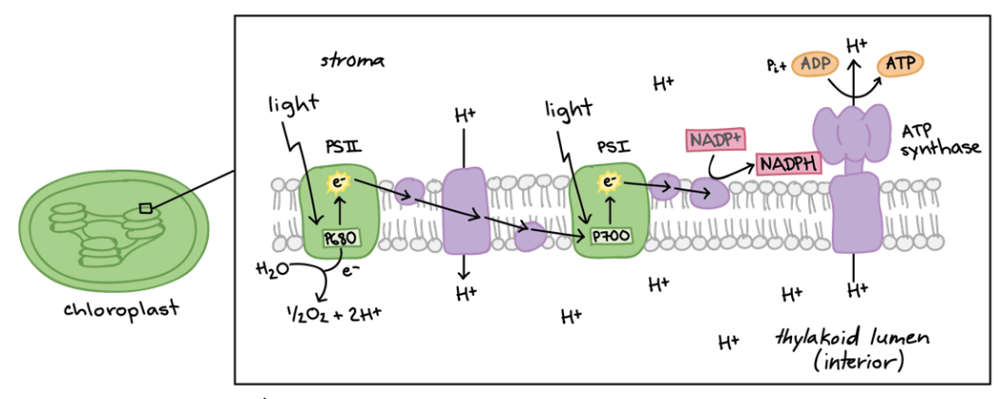
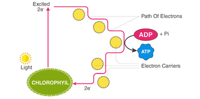

## Light Dependent Stage

* Occurs in the thylakoid membranes

* Light energy is trapped and used for photoactivation, photolysis and the synthesis of ATP & NADPH

* The ATP and NADPH produced are passed to the light-independent stage

* Phosphorylation of ADP to ATP can be cyclic or non-cyclic

**Non-Cyclic photophosphorylation**

* Involves both photosystems

* Also referred to as the **Z-scheme**

* Water splits into H⁺ and OH⁻ in a process called **photolysis**, and electrons are removed from the OH⁻

  * $H_2O → 2H^{+} + ½O_2 + 2e^{-}$

  * The O₂ is released as a waste gas, diffusing out of the chloroplast to be used in aerobic respiration or to leave the cell

* Light energy is absorbed by PSII and passed down to the reaction center, where electrons in chl-a molecule become excited in a process called **photoactivation**

* The excited electrons are emitted from the chlorophyll, and they are replaced by the electrons produced from photolysis

* The emitted electrons are captured by an electron acceptor and passed along the ETC to make ATP through chemiosmosis

* The energy from the electrons is used to actively transport protons from the stroma, across the thylakoid membrane, into the thylakoid space

* A gradient is set up and protons move down their concentration gradient through ATP synthase molecules to synthesize ATP from ADP \+ Pi

* The electrons from PSII are then passed to PSI, where they are excited again when PSI absorbs light energy too (photoactivation)

* These electrons combine with the H⁺ ions produced in photolysis to reduce NADP to NADPH

* NADP \+ 2H⁺ \+ 2e⁻ → NADPH

* This process produces ATP and NADPH which are necessary for the LIDS

**Cyclic photophosphorylation:**

* Involves only PSI

* Occurs when there is an ATP deficit, but the cell does not need more NADPH, so this process only produces more ATP

* No photolysis occurs and no NADPH is formed

* Light energy is absorbed by PSI and passed to the reaction center

* Electrons in the chl-a molecule become excited (photoactivation) and are emitted from the molecule

* The emitted electrons are captured by an electron acceptor and passed along an ETC to make ATP through chemiosmosis (described above)

* The electrons then return to the original photosystem PSI

**Difference between cyclic and non-cyclic:**

#|
||

Non-cyclic Photophosphorylation

|

Cyclic Photophosphorylation

||
||

Both PSI and PSII involved

|

Only PSI involved

||
||

Photolysis occurs

|

Photolysis does not occur

||
||

Products: ATP, NADPH, O2

|

Products: Only ATP

||
||

Purpose: ATP \+ NADPH for LIDS

|

Purpose: Extra ATP

||
|#

