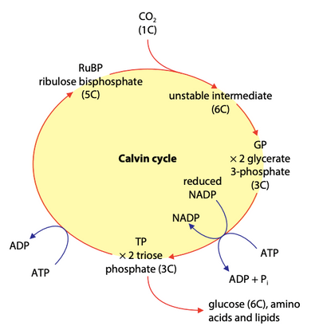

## Light Independent Stage

* Also known as the Calvin Cycle

* Occurs in the stroma

* Does not require light, but still cannot go on for long in darkness as it needs inputs from the light-dependent stage

* 3 steps:

1. Fixation of CO₂:

* Carbon dioxide combines with **ribulose bisphosphate (RuBP)** to produce **glycerate-3-phosphate,** two molecules of GP

* This is catalyzed by the enzyme ribulose bisphosphate carboxylase, a.k.a **rubisco**

* CO₂ is said to be fixed as it has been removed from the environment and is part of the plant cell

2. Reduction of GP

* GP is reduced to **triose phosphate (TP)** x2, using energy from ATP and hydrogen from NADPH

3. Regeneration of RuBP

* **5/6** of the TP molecules are used to regenerate RuBP, using more ATP

* The rest (**1/6**) are converted to other molecules needed by the plant

* Some triose phosphates condense to become hexose phosphates

* These are used to produce

  * starch for storage

  * sucrose for translocation

  * cellulose for making cell walls

* GP can be converted to glycerol and fatty acids, to produce lipids for cell membranes

* Plants can produce all 20 of the natural amino acids for protein synthesis, using ammonium ions from the soil and carbohydrates from the Calvin Cycle