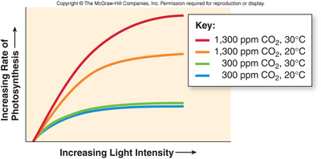

## Limiting Factors

* These are factors that restrict a process’s rate when in short supply

* The main factors that affect photosynthesis are CO₂ concentration, light intensity, and temperature

### Light intensity:

* Photosynthesis increases with increasing light intensity, until CO₂ concentration or temperature becomes limiting

* Light provides energy for the light-dependent reactions

* The graph levels off when one of the other 2 factors becomes limiting, and light intensity is not a limiting factor anymore

### CO₂ concentration:

* Photosynthesis increases as CO₂ concentration increases until light or temperature becomes limiting

* It is the raw material in the Calvin Cycle, where it is fixed into GP

### Temperature:

* Photosynthesis increases as temperature increases

* However, after optimum temperature, the rate decreases because enzymes denature