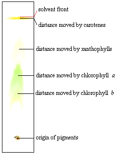

## Chromatography

- Grind leaf using a mortar and pestle with solvent such as propanone

- Leaf extract contains mixture of pigments

- Allow the sample to evaporate to concentrate the pigment

- Draw a pencil line and place extract on it using a capillary tube

- Place paper vertically in jar of different solvent

- Solvent rises up paper with each pigment traveling at different
  speeds hence pigments separated

- Distance moved by each pigment is unique

- Use Rf value to identify each pigment

$$
R_{f}= \frac{\text{distance\ travelled\ by\ pigment}}{\text{distance\ travelled\ by\ solvent}}
$$

- Repeat with a different solvent, placing the chromatogram 90° to the
  original alignment