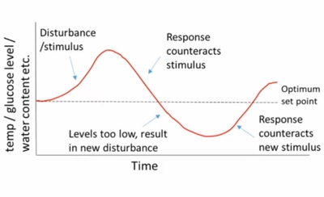

## Homeostatic Control

### Negative feedback:

* Negative feedback keeps factors within narrow limits, making it as close to the set point as possible
* Components:

1. Stimulus: An internal or external change in the factor away from the set point

2. Receptor: A cell/tissue/organ which detects the stimulus

3. Control Centre: A tissue which receives and processes messages (hormones or nerve impulses) from the receptors and determines an appropriate response

4. Effector: Carries out a corrective action as a response

* The factors never stay exactly constant at the set point, but fluctuate a little above and below it

### Positive feedback

* When a change in some factor brings about changes that enhance the initial stimulus

* When you get a cut, **blood clotting** acts as a positive feedback loop to stop the bleeding. Platelets stick to the wound and release chemicals that attract more platelets, triggering a rapid chain reaction. This loop amplifies itself until a solid clot forms and seals the injury.

* This loop amplifies itself until a solid clot forms and seals the injury.

### Differences between positive and negative feedback:

#|
||

Negative Feedback

|

Positive Feedback

||
||

Response counteracts the original stimulus

|

Response reinforces the original stimulus

||
||

Common

|

Uncommon

||
||

e.g. Maintaining temperature and blood glucose levels etc.

|

e.g. Labor pains, fruit ripening, inhalation of CO₂

||
|#

