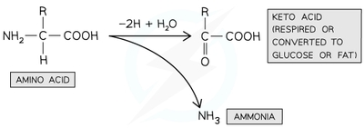

## Excretion

* Excretion is the removal of unwanted waste products of metabolism

* Toxic and poisonous waste products are removed because they would otherwise cause damage to tissues

### Main excretory products:

1. Carbon Dioxide:

* Produced in aerobically respiring cells

* Transported in the bloodstream and excreted via lungs

2. Creatinine:

* **Creatine** is produced in the liver from certain amino acids

* It acts as an energy store in muscles, in the form of **creatine phosphate**

* Some of it is converted to **creatinine**, which is excreted via kidneys

3. Uric acid:

* Produced in the liver from excess purines of nucleotides

* Excreted via kidneys

4. Urea:

* Main nitrogenous excretory product

* Produced in the liver from excess amino acids, through **deamination** and the **urea cycle**

* Transported in solution in blood plasma and excreted via kidneys

### Deamination:

* The **amine** group (-NH₂) and a hydrogen atom are removed from an amino acid, then combine to form ammonia (NH₃) and a **keto acid**

* This occurs in the liver when there is excess protein, so that the useful energy source is not wasted

* Ammonia is a soluble and highly toxic compound which is immediately converted to urea in the urea cycle, which is less soluble and less toxic

* Urea cycle: NH₃ + CO₂ → urea

* The remaining keto acid may enter the Krebs Cycle and be respired, or converted to glucose, glycogen or fat