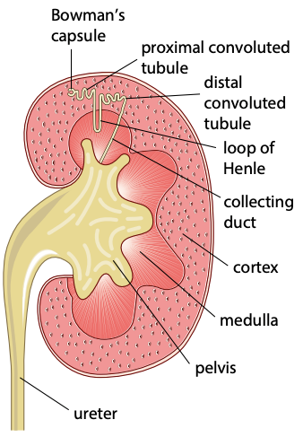
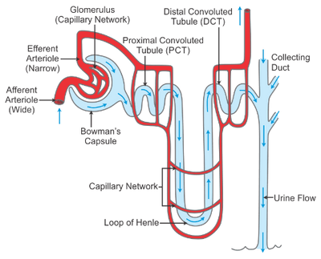

## Structure of the Kidney

* 3 regions: **cortex**, **medulla** and **pelvis**

* Covered by a tough protective layer called the **capsule**

* Made up of thousands of **nephrons**

* Receives blood from a renal artery and returns blood through a renal vein

* The **ureter** carries urine from the kidney to the bladder

* The **urethra** carries urine from the bladder outside the body

### Structure of a Nephron:

* One end forms the **Bowman’s capsule**, which surrounds a capillary network known as the **glomerulus**

* The next part of the nephron tubule is a twisted region called the **proximal convoluted tubule**

* It loops down into the medulla, forming the **loop of Henle**

* The tubule forms another twisted region called the **distal convoluted tubule**

* There is a **collecting duct** that moves through the medulla into the pelvis

* Blood enters each glomerulus through **afferent** arteriole from the renal artery and leaves through **efferent** arteriole

* The efferent arteriole forms a capillary network around the nephron tubules before blood is drained into the renal vein