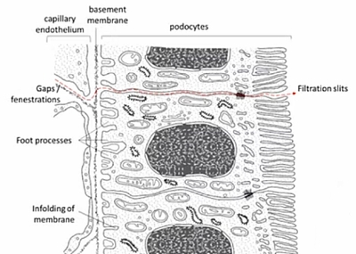

## Ultrafiltration

* Small molecules including urea are filtered out of the blood in the glomerulus and enter the Bowman’s capsule to form filtrate

* The filtrate flows along the nephron towards the collecting duct

### Structure of Walls:

* The blood in glomerulus is separated from lumen of Bowman’s capsule by 3 layers
* Allows movement of substances from blood plasma into Bowman’s capsule lumen

**1) Endothelium of glomerular capillaries**

* Each endothelial cell is perforated by many circular holes, 60-80nm in diameter

**2) Basement Membrane**

* A mesh of collagen and glycoproteins

* Acts as main selective barrier, stopping RBCs, WBCs and large protein molecules from passing

* Any molecule with a relative molecular mass above **69000 Da** cannot pass

**3) Epithelial cells of Bowman’s capsule (podocytes)**

* The inner lining of the capsule, which wraps around the glomerulus

* The cells, called podocytes, have many finger-like projections that form filtration slits

### Glomerular Filtration Rate:

* The rate at which the fluid filters from the blood in the glomerulus

* The rate is **125 cm³/min** in a human in both kidneys

* Affected by:

1. **Glomerular pressure:** Higher glomerular pressure increases the GFR

2. **Diameter of arterioles:** Dilation of afferent arteriole and constriction of efferent arteriole increases glomerular pressure, therefore increasing GFR

3. **Water potential:** Large molecules remain in blood of glomerulus, decreasing the W.P so water tends to move from the capsule into the glomerulus, opposing filtration. However, the high pressure in the glomerulus is greater, resulting in the net movement of water into the capsule 

### Glomerular Filtrate:

* No cells or large proteins

* Contains water, amino acids, glucose, urea, inorganic ions, uric acid, creatinine, vitamins

* Passes through gaps between podocytes and into Bowman’s capsule