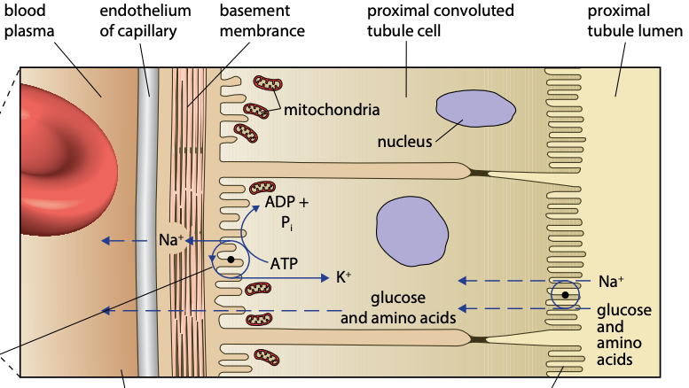

## Reabsorption in Proximal Convoluted Tubule (PCT)

* Main site for glucose, amino acids, vitamins and Cl⁻ ions reabsorption

* The lining is made up of a layer of cuboidal epithelial cells

1. Na⁺ ions are actively transported from PCT lining cells into the blood, through sodium-potassium pumps, using energy from ATP

* Concentration of Na⁺ ions in the PCT cell decreases

2. Na⁺ ions in the PCT lumen diffuse down its gradient into the epithelial cell by facilitated diffusion, through cotransporter proteins

* Na⁺ is transported with something else, e.g. glucose

3. The glucose (example) diffuses into the blood through a transport protein

* Glucose, amino acids, vitamins and Cl⁻ ions are all actively reabsorbed

* Urea is passively reabsorbed

* The removal of solutes increases water potential of the filtrate in PCT lumen, so water moves passively too by osmosis into blood

### Adaptations of PCT cells:

1. Many microvilli facing the lumen: Increases surface area for reabsorption of substances from the filtrate in the lumen

2. Many different transport proteins in the luminal membrane e.g. cotransporters, pumps, aquaporins

3. Tight junctions holding adjacent cells firmly together: so that substances pass **through** cells and not between them, and prevents mixing of luminal fluid and intracellular fluid

4. Numerous mitochondria: Provide energy for the sodium-potassium pumps

5. Infolding of basal membranes: Increases the number of transport proteins