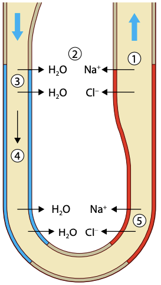

## Reabsorption in Loop of Henle

* The loop of Henle is located in the medulla

* Mainly reabsorbs water to prevent dehydration

* Its function is to create a high concentration of Na⁺ and Cl⁻ ions in the tissue fluid in the medulla, by active transport

**At ascending limb: (permeable to salts, not water)**

1. Na⁺ and Cl⁻ ions are actively transported out into the tissue fluid of medulla, making the area more concentrated

**At descending limb: (permeable to water, not salts)**

2. Water moves down the concentration gradient into the solute-concentrated tissue fluid

3. Salts diffuse into the descending limb, so the filtrate inside becomes more concentrated as it moves down

* A longer loop means more water reabsorption due to higher concentration of salts built up in medulla space, resulting in more concentrated urine

### Reabsorption in Distal Convoluted Tubule (DCT):

* First part of it functions similar to ascending limb of Loop of Henle

* Second part functions similar to the collecting duct

### Reabsorption in the Collecting Duct:

* After passing through the DCT in the cortex, the filtrate moves down the collecting duct in the medulla

* The medulla has a high salt concentration, so water moves out by osmosis, until the water potential of urine is the same as of tissue fluid

* The rate of water reabsorption is controlled by the **antidiuretic hormone (ADH)**