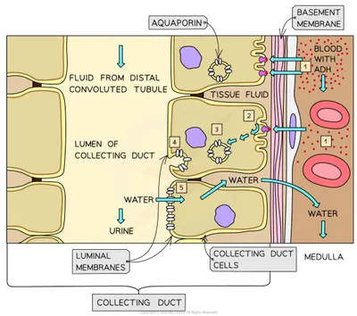

## Osmoregulation

- Osmoregulation is the control of water potential of body fluids

- **Osmoreceptors** in the **hypothalamus** monitor the water potential of blood

- Negative feedback mechanism is used

### Response to low water potential of blood: (High ADH)

* In summary, water moves through aquaporins out of DCT/ collecting duct into medulla tissue fluid to increase water potential of blood

1. Osmoreceptor cells sense a decrease, so nerve impulses are sent to the **posterior pituitary gland**

2. ADH is released from the gland and enters the bloodstream, moving to the second part of DCT and collecting duct

3. ADH binds to receptors on the membrane of the DCT and duct, stimulating the production of **cyclic AMP (cAMP)**

4. cAMP activates a signaling cascade, leading to the phosphorylation of aquaporin molecules, which are water permeable channels

5. The activation of aquaporin molecules causes the vesicles containing aquaporins to move toward the luminal membrane and fuse with it

* This increases the permeability of the membrane to water

* More water flows out of the DCT/duct through the aquaporins down the water potential gradient into the tissue fluid (which has lower water potential)

* Water potential of blood therefore returns to set point

* Small volumes of concentrated urine produced

* ADH is produced in the hypothalamus and then transferred to the posterior pituitary gland, from where it is released

### Response to high water potential of blood: (Low ADH)

* Osmoreceptors are no longer stimulated

1. Neurones in the posterior pituitary gland stop secreting ADH

2. Aquaporins move out of the cell surface membrane, back into the cytoplasm as part of the vesicles

3. The fluid flows down the collecting duct without losing water, so dilute urine collects in the pelvis and flows down the ureter to the bladder

* It takes time for ADH already in blood to be broken down, so aquaporins are taken into cytoplasm after 15-20 minutes once ADH stops arriving at the cells

* Large volumes of dilute urine produced