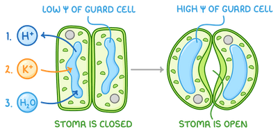

## Opening and closing of stomata

### **Opening of stomata:**

1. Proton pumps actively transport H⁺ ions out of the guard cells in response to light, making the inside of the cell more negative

2. This causes potassium ion channels to open so that K⁺ ions move into the cell by facilitated diffusion, down the **electrochemical gradient** formed

* The electrochemical gradient results from the electrical gradient formed by the removal of H⁺ ions, and the concentration gradient of K⁺ ions

3. Other ions like chloride and nitrate (both negative) also enter to maintain charge balance

4. The influx of solutes decreases the water potential inside the cell, so water moves in by osmosis through aquaporins

5. Volume of the cell increases, making it turgid so the stomata open

### Closing of stomata:

* Stomata closes when proton pumps stop and K⁺ ions leave guard cells, reversing the water potential gradient so water exits and the cell becomes flaccid

* The hormone **abscisic acid** (**ABA**) stimulates stomatal closure

* ABA is a stress hormone produced when the plant experiences extreme environmental conditions such as very high temperatures or water shortages

1. ABA binds to specific receptors on the guard cell membranes, inhibiting proton pumps and stimulating Ca²⁺ ion influx

2. Ca²⁺ acts as a second messenger, activating channel proteins to allow ions to leave the guard cells, and closing the K⁺ ion channels

3. The removal of solutes increases the water potential inside the cell, so water leaves the cell by osmosis and the cell becomes flaccid so stomata close

