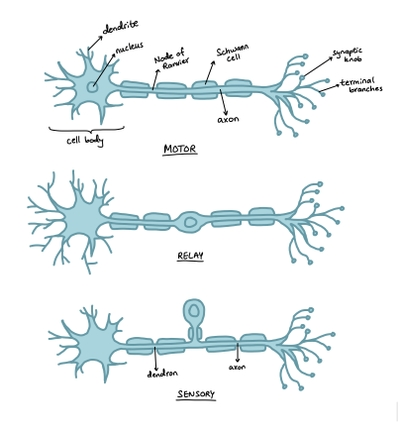
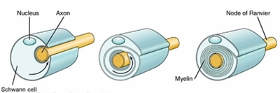

## Neurones

* Nerves are bundles of neurones

* Nerve impulses travel along these neurones at high speeds

* 3 types:

1. Sensory Neurones:

* Transmit impulses from receptors to the CNS

* Located in the PNS

2. Relay Neurones:

* Transmit impulses from sensory to motor neurons

* Located in the CNS

3. Motor Neurones:

* Transmit impulses from the CNS to effectors

* Cell body in CNS, axons extend to PNS

### Neurone structure:

* **Cell body (also known as soma):**

  * Has cytoplasm and the neurone’s nucleus, ribosomes, Golgi apparatus, and rough ER

* **Dendrites:**

  * They are cytoplasmic extensions of the cell body

  * Carry impulses towards the cell body

  * Highly branched to provide a large surface area for the axon terminals of other neurones

* **Axons:**

  * Much longer cytoplasmic processes than dendrites

  * Carry impulses away from the cell body

  * Some are enclosed in a myelin sheath

  * Diameter is directly proportional to speed

* **Myelin:**

  * Speeds up conduction of impulses by insulating the axons and preventing leakage of ions

  * Made of layers of **Schwann cells**, which wrap themselves around the axon

  * The myelin sheath is made up of phospholipids and proteins, so they are impermeable to water and ions in the tissue fluid

* **Nodes of Ranvier:** 2-3 µm long

  * Gaps between Schwann cells

  * All the channel proteins and pumps are concentrated at these nodes

  * Exposed to tissue fluid due to the absence of myelin

  * Occur about every 1 to 3 mm in human neurons

  * During saltatory conduction caused by myelin, action potentials jump from one node to the next to speed up impulse transmission by 50x