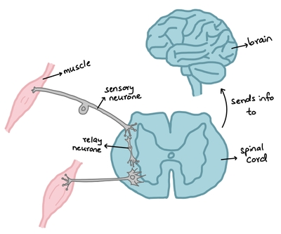

## Reflex Arc

* The pathway along which impulses are transmitted from a receptor to an effector without involving the conscious regions of the brain

* Faster than regular impulse transmission

* e.g. blinking, removing the hand from a hot object, focusing the eye

