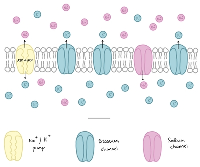
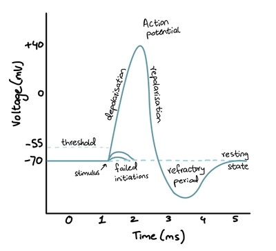

## Transmission of Nerve Impulses

* A nerve impulse begins with depolarization of the membrane, which generates an action potential (aka the impulse)

### Resting potential:

* This is the difference in electrical potential across the neurone’s membrane when it is not sending a signal

* The inside has a more negative potential than the outside (**-70mV**)

* This potential difference is maintained by keeping the inside more negative through:

1. Sodium-potassium pumps:

* Use ATP to pump ions, keeping the inside more negative

* 3Na⁺ ions are removed and 2K⁺ ions are brought in for every 1 ATP molecule hydrolyzed

* Occurs against concentration gradient

2. More potassium ion channels open than sodium channels:

* More K⁺ ions diffuse out than Na⁺ diffusing in

* This diffusion occurs down the gradient, so movement is not in the same direction as the Na⁺-K⁺ pumps

3. Plasma membrane being impermeable to ions:

* Sodium ions cannot diffuse through the membrane while the axon is at rest

### Action Potential:

* A brief change in the potential difference from **-70mV to +30mV**, caused by the inward movement of Na⁺ ions

* This change in potential difference is known as depolarization, as the negative charge is lost and the charge inside becomes more positive

### Depolarization: (how a nerve impulse is transmitted)

1. An electric current causes voltage-gated Na⁺ ion channels in the membrane to open

2. Na⁺ ions enter the cell due to a greater concentration of Na⁺ ions outside, and the inside becomes less negative (depolarized)

3. The depolarization triggers more channels to open, so more Na⁺ ions enter

4. If the potential difference reaches **-50 to -60 mV** **(threshold potential)**, an action potential is generated; if it is lower, action potential is not generated

Along a non-myelinated neurone:

* This depolarization spreads to adjacent areas, causing the new areas to reach threshold potential and generate their own action potential

* A local circuit is set up

Along a myelinated neurone:

* Action potentials move by saltatory conduction

* Depolarization and action potentials cannot occur because Na⁺ and K⁺ ions cannot pass through myelin sheath

### Repolarization:

1. Voltage-gated Na⁺ ion channels close 1 ms later, so Na⁺ ions stop diffusing in

2. Voltage-gated K⁺ ion channels open, allowing K⁺ ions to diffuse out of the axon down their concentration gradient

3. The loss of positive ions makes the inside become more negative and return to resting potential

4. When the axon transmits a nerve impulse again, K⁺ ion channels close and Na⁺ ion channels open again to continue the cycle

### Hyperpolarization/Refractory period:

* A period of time during which a neurone is recovering from an action potential, and will be unresponsive to an electric current

* It occurs because there is a delay in closing K⁺ ion channels, leading to a slight overshoot into more negative potential

* Due to this hyperpolarization, action potentials are discrete, meaning they do not merge into each other

* The length of this period determines the maximum frequency of action potentials: **Refractory period ∝ 1​/Max frequency**

### All or None Law:

* Neurones either transmit impulse or they do not

* If potential difference is sufficient, an impulse will be generated, otherwise it will not

A strong stimulus produces a higher frequency of action potentials, stimulating more neurons, while a weak one produces a lower frequency and stimulates just a few, so the number of neurons affected tells us about the strength of a stimulus

Thicker axons transmit impulses faster because they have a greater surface area over which ions can diffuse