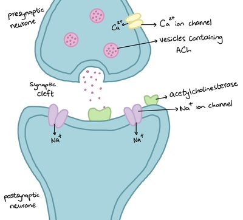

## Synapses

* The junction between neurones/muscles (**20nm** wide)

* Noradrenaline and **acetylcholine** (ACh) are neurotransmitters found throughout the nervous system

* Cholinergic synapses are those that use ACh as a neurotransmitter

* How synapses work:

1. Action potential reaches presynaptic neurone

2. This causes voltage-gated Ca²⁺ ion channels to open, and Ca²⁺ ions enter

3. Influx of Ca²⁺ stimulates vesicles containing ACh to move toward and fuse with the presynaptic membrane

4. The vesicles release ACh, which diffuses across the synaptic cleft (in under 0.5 ms)

5. ACh binds with receptor proteins on the postsynaptic membrane as it has a complementary shape

6. The protein changes shape and opens to allow Na⁺ ions to diffuse into the postsynaptic neurone, depolarizing it and therefore generating an action potential

7. **Acetylcholinesterase** catalyzes the breakdown of ACh into **acetate** and **choline**, using energy from ATP

* Choline is taken back to presynaptic neurone, reacting with acetyl coenzyme A to form ACh again

* ACh is recycled because if it remained bound to the receptors, Na⁺ ion channels would remain open and permanent depolarization would occur, causing synaptic paralysis

### Role of Synapses:

1. Ensure one-way transmission, as neurotransmitters are released on one side and its receptors are on the other side

2. Allow interconnection of nerve pathway; impulses split over a wide range

3. Involved in memory and learning when new synapses are formed

4. Filter out low-level stimuli, which prevents brain from sensory overload