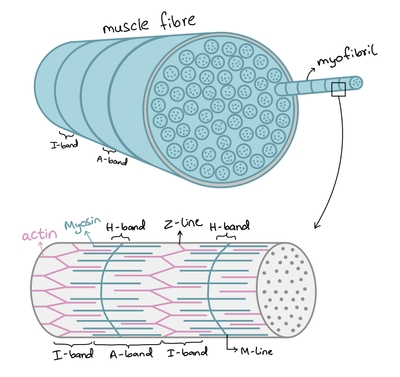
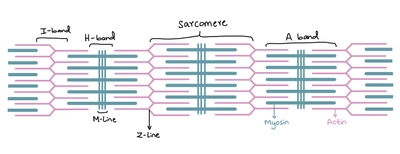

## Striated muscle:

* A type of muscle tissue in skeletal muscles

* They are striped as seen under a microscope

* Attached to the bones by tendons

* Only contract when impulses stimulate them to do so

### Structure:

* Muscles are made up of muscle fibres, which are specialized cells called syncytium as they are multinucleated

* **Sarcolemma** (the cell surface membrane) has deep infoldings called transverse system tubules (T-tubules), and can conduct action potentials

* **Sarcoplasm** (the cytoplasm) has many parallel myofibrils, mitochondria, and multiple nuclei

* **Sarcoplasmic reticulum** (the endoplasmic reticulum) has protein pumps that transport Ca²⁺ ions into the cisternae

* Each muscle fiber contains many **myofibrils** that run parallel to each other

* Each myofibril is made up of **sarcomeres** (between 2 Z-discs), which give striated muscles its banded appearance

### Sarcomere:

* Contractile unit of myofibril

* Consist of **actin** (globular protein, make up the thin filaments) and **myosin** (fibrous protein, make up the thick filaments)

* A-bands: Dark parts, contains overlapping actin and myosin

* H-bands: Lighter area within A-band, contains only myosin

* I-bands: Lightest areas, contains only actin

* M-line: Centre of the sarcomere, where myosin filaments are

* Z-lines: The boundaries of the sarcomere, where actin filaments are

* During contraction, the A-band stays the same while H-bands and I-bands shorten

**Troponin**: A calcium-binding protein that is part of the thin filaments

**Tropomyosin**: A fibrous protein that is part of the thin filaments, blocking myosin binding sites