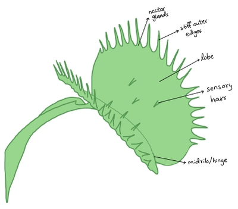

## Plant Coordination

### Differences and similarities between plant and animal coordination:

#|
||

Similarities

|

Differences

||
||

Both have electrochemical gradients

|

Depolarization in mammals is caused by influx of Na⁺ ions, while in plants it is caused by exit of Cl⁻ ions

||
||

Both have sodium-potassium pumps

|

Action potentials travel along neurons in mammals, while in plants they travel along cell membranes and via plasmodesmata

||
||

Both have resting potential

|

Transmission is faster in mammals and slower in plants

||
|#

### Venus Flytrap:

* Scientific name: *Dionaea muscipula*

* A carnivorous plant that traps and digests small animals (mainly insects) to obtain nitrogen compounds

Structure:

* Divided into 2 lobes on either side of the midrib (hinge)

* The insides of the lobes are red and have nectar glands, to attract insects

* The stiff hairs on the outer edges interlock to capture the insect

* The digestive glands secrete enzymes to digest trapped insects

* When insects stimulate the sensory hairs, action potentials are generated which causes the leaf to fold

How it works:

1. If 2 sensory hairs are touched within 20 seconds of each other, Ca²⁺ channels open at the hair base to allow Ca²⁺ ions in

2. Ca²⁺ influx causes depolarization, generating action potentials that spread over the lobes to the hinge cells

3. H⁺ is pumped out of the hinge cells into their cell walls, lowering the pH

4. Low pH breaks cross-links in the cell wall and dissolves calcium pectate in the middle lamella, so the cell wall loosens

5. Ca²⁺ ions enter the hinge cells, lowering water potential so water enters too

6. The cells become turgid and expand, which causes the lobes to change shape from convex to concave, so the trap shuts quickly in 0.3 seconds

7. Further deflection of sensory hairs triggers more action potentials, sealing the trap and causing Ca²⁺ entry into digestive gland cells

8. Ca²⁺ stimulates gland cells to release digestive enzymes via exocytosis of vesicles containing the enzymes

* The trap stays shut for up to 1 week for digestion

* After digestion, cells on the upper surface of the midrib grows slowly, reopening the leaf and the elastic tension builds again

* Stimulation of a single hair does not trigger closing, so the trap doesn’t close due to rain or debris falling inside

* Gaps between stiff hairs allow tiny insects to crawl out to avoid wasting energy on digesting a small meal