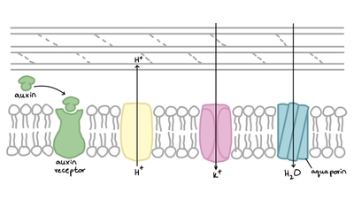
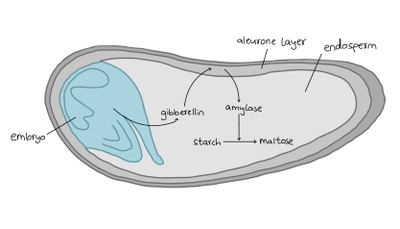

## Plant Growth Regulators

* These are chemicals produced in plants that influences their growth and development

* e.g. auxins, gibberellins, abscisic acid

* They move from cell to cell by diffusion/active transport, or through phloem and xylem vessels in the sap

### Auxins:

* Influence growth by cell elongation at root and shoot tips

* Inhibit lateral growth (branching)

* Main auxin is **IAA**, indole-3-acetic acid (referred to as just auxin)

* IAA is made in meristems (growing tips) where cells are dividing by mitosis

* Higher concentration of auxin = more cell elongation

* Uneven distribution of auxin causes tips to bend in response to stimuli (like how shoots bend toward sunlight)

* Pruning removes auxin from the tips, which encourages dormant lateral buds to develop, so branching occurs to produce bushier plants

### Acid Growth Hypothesis:

1. Auxin binds to receptors in the cell membrane

2. This stimulates proton pumps to actively pump H⁺ ions into the cell wall

3. Cell wall becomes acidified, which activates **expansins** (pH-dependent enzymes)

4. Expansins loosen the linkages between cellulose microfibrils by breaking hydrogen bonds

5. Ions (e.g. K⁺ ions) enter the cell, decreasing water potential so water enters the cell by osmosis, through aquaporins

6. Turgor pressure is increased, expanding the cell wall

7. The cell wall stretching causes the cell to elongate

* The hypothesis is supported because:

1. Cell elongation can be prevented by neutralizing the acidity of cell walls using a buffer (showing that acidity is involved in elongation)

2. Protons are released from cells in response to auxin

3. Cell elongation can be caused by acids

### Gibberellins:

* Involved in seed germination and controlling stem elongation

* Made in young leaves, seeds and stems

Role in seed germination:

* When a seed is shed, it is **dormant** (metabolically inactive) and has little water

* DELLA proteins inhibit cell growth and seed germination to maintain dormancy

1. The seed absorbs water, stimulating the **embryo** to produce gibberellins

2. Gibberellins diffuse into the **aleurone layer**, stimulating cells to synthesize amylase by increasing mRNA transcription

3. Gibberellins also destroy the DELLA proteins that inhibit transcription

4. Amylase diffuses into the **endosperm**, where it hydrolyses starch into maltose, which is then converted to glucose

5. The glucose is transported to the embryo, providing a source of energy as the embryo grows