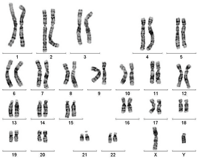

# Inheritance

## Inherited Change

### Key Terms:

* **Gene:** A length of DNA that codes for a polypeptide

* **Allele:** A form of a gene occupying the same locus

  * e.g. B (brown eyes) and b (blue eyes) are alleles of the same gene for eye color

* **Locus:** The position of a gene on a chromosome

* **Genotype:** The genetic composition of an organism (the alleles they possess) e.g. BB

* **Phenotype:** The observable characteristics of the organism

* **Dominant Allele:** Expressed even if only 1 copy is present

* **Recessive Allele:** Expressed only if 2 copies are present

### Gametes:

* Gametes are reproductive cells that fuse together in a process called **fertilization** to form a **zygote**
* The zygote then divides by mitosis to form a multicellular organism
* This is sexual reproduction

### Homologous Chromosomes:

* A pair of chromosomes that carry the same genes in the same positions

* There are 23 **pairs** of homologous chromosomes in humans (46 in total)

  * First 22 pairs: **Autosomes** (the chromosomes that do not determine sex)

  * Last 23rd pair: Sex chromosomes (XX in females and XY in males)

* One chromosome in the homologous pair is inherited from the mother, the other from the father

* For a specific gene, each homologous chromosome in the pair carries one allele for it.

  * If both these alleles are same e.g. BB, the person is homozygous

  * If the alleles are different e.g. Bb, the person is heterozygous

* A **karyogram** shows chromosomes that are arranged into homologous pairs:

* Haploid cells: Contain 1 set of chromosomes (n)

  * Result of meiosis

  * e.g. gametes like sperm and egg cells, n = 23

* Diploid cells: Contain 2 sets of chromosomes (2n), one from each parent

  * Result of mitosis

  * e.g. somatic cells (all cells except gametes), 2n = 46