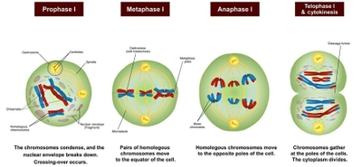
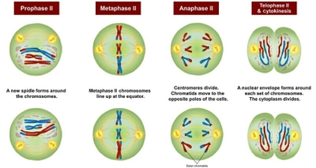

## Meiosis

- Nuclear reduction division in which a diploid cell divides to form 4 haploid daughter cells, halving the chromosome number

- Ensures the chromosome number remains constant by halving it before fertilization

- Produces genetic variation in offspring

### Meiosis I: Chromosome number is halved

### Prophase I:

1. Chromatin condenses into chromosomes

2. Centrosomes move to opposite poles and begin forming the spindle fibres

3. Nuclear envelope and nucleolus break down

4. **Synapsis** occurs: homologous chromosomes pair up to form a **bivalent**

5. **Crossing over** in bivalents occurs: Chromatids may break and reconnect to another, non-sister chromatid, exchanging genetic material at points called **chiasmata**

* At the end of Prophase I, a spindle is formed

### Metaphase I:

1. Bivalents line up across the spindle’s equator, attached by centromeres

2. **Independent assortment** of homologous chromosome pairs occurs: each pair lines up independently of others, randomly, leading to different combinations

### Anaphase I:

1. Spindle fibers shorten

2. Homologous chromosomes separate

3. *Whole chromosomes* are pulled to opposite ends of the spindle

* Centromeres do not divide (each chromosome still consists of 2 sister chromatids)

### Telophase I:

1. Chromosomes reach opposite poles of the spindle, and partially decondense

2. Nuclear envelope and nucleolus reform (except in plant cells, where meiosis proceeds directly to Meiosis II)

3. Spindle fibers break down

4. Cytokinesis occurs, forming 2 haploid daughter cells

* Animal cells divide completely before Meiosis II

### Meiosis II: Just like mitosis

### Prophase II:

1. Chromatin condenses into chromosomes

2. Centrosomes move to opposite poles and start forming the spindle

3. Nuclear envelope and nucleolus break down

### Metaphase II:

1. Chromosomes line up at the equator, at right angles to first equator

2. Independent assortment of sister chromatids occurs. further increasing variation

### Anaphase II:

1. Spindle fibers shorten

2. Sister chromatids are split at centromere

3. *Chromatids* are pulled to opposite poles

### Telophase II:

1. Chromatids reach the poles and decondense into chromatin

2. Nuclear envelope and nucleolus reform

3. Spindle fibers break down

4. Cytokinesis occurs, producing 4 unique haploid daughter cells

### How meiosis causes genetic variation:

1) Crossing over allows exchange of genetic material to take place at Prophase I

2) Independent assortment of homologous chromosomes occurs at Metaphase I

3) Independent assortment of chromatids occurs at Metaphase II

4) Possible chromosome mutation

* Faulty meiosis may cause changes in chromosome number e.g. Down Syndrome

5) Random Fertilization

* Random mating and random fusion of gametes leads to many different possible genetic combinations