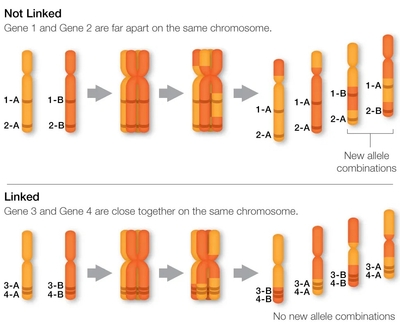

## Autosomal Linkage

* This refers to the inheritance of genes located on the same **autosome** (non-sex chromosomes)

* Autosomal linked genes are said to be in the same linkage group, like in sex linkage

  * They are less likely to be separated during independent assortment because their loci are close together

* Brackets are used in genotypes to show they are on the same chromosome e.g. (EA)(EA) instead of EEAA

* Example: The genes for body color and antennal shape in *Drosophila* (fruit fly) are close together on the same autosome, so they are linked

  * Gene 1, body color: **E** = striped body, and **e** = ebony body

  * Gene 2, antennal shape: **A** = normal antennae, and **a** = aristopedia antennae

* Cross between **(EA)(ea)** and **(ea)(ea)**:

  * (EA)(ea) gametes: **(EA)** and **(ea)**

  * (ea)(ea) gametes: **(ea)**

#|
||

Gametes

|

(EA)

|

(ea)

||
||

(ea)

|

(EA)(ea)

striped body, normal antennae

|

(ea)(ea)

ebony body, aristopedia antennae

||
|#

* Crossing over breaks the linkage between 2 linked genes

* In male *Drosophila*, no crossing over takes place (reason unknown) but it does occur in female *Drosophila*

* When crossing over occurs, new allele combinations (Ea and eA) form

#|
||

Gametes

|

(ea)

||
||

(EA) (majority)

|

(EA)(ea)

striped body, normal antennae

||
||

(ea) (majority)

|

(ea)(ea)

ebony body, aristopedia antennae

||
||

(Ea) (few)

|

(Ea)(ea)

striped body, aristopedia antennae

||
||

(eA) (few)

|

(eA)(ea)

ebony body, normal antennae

||
|#

**Parental type**: Offspring that have the same characteristics as their parents

**Recombinant**: Offspring that show different combinations of characteristics from their parents