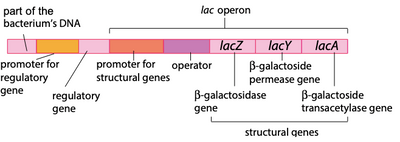
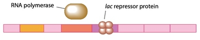
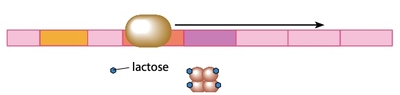

## Gene Control in Prokaryotes

* Main example: gene control in *Escheria coli*

* An **operon** is a length of DNA containing a cluster of genes controlled by the same promoter (definition)

  * This group of genes is transcribed as a single mRNA molecule

* The operon responsible for the production of lactose in bacteria is the ***lac* operon**

* The lac operon consists of: a promoter, operator, and 3 structural genes:

  * **Promoter:** Site where RNA polymerase binds to initiate transcription

  * **Operator:** The DNA sequence where a **repressor protein** binds

    * The **regulatory gene** (*lacI*) that codes for the repressor protein is close by

  * 3 structural genes:

1. *lacZ*, coding for **B-galactosidase**

2. *lacY*, coding for **permease**

3. *lacA*, coding for **transacetylase**

* B-galactosidase (a.k.a. lactase) is an **inducible** enzyme that hydrolyses lactose into glucose and galactose

* It allows *E.coli* to use lactose as an energy source when other carbon sources (like glucose) are absent

* The expression of *lacZ* depends on the concentration of lactose in the bacterium’s environment

* When lactose is present, *E.coli* activates the expression of the lac operon, leading to the synthesis of B-galactosidase (lactase)

### Repressor Protein

* Prevents transcription of the structural genes when it binds to the operator

* It has 2 binding sites, one for DNA and one for lactose

* When lactose binds to its site, the shape of the protein changes so that the DNA binding site is closed, therefore inactivating the repressor

### When lactose is absent: (Genes switched off)

1. Regulatory gene codes for repressor protein

2. Repressor binds to the operator, preventing RNA polymerase from binding to DNA

3. As a result, transcription does not occur

### When lactose is present: (Genes switched on)

1. Lactose is taken up by the bacteria and binds to the repressor protein, changing its shape so that it can’t bind to the DNA

2. RNA polymerase binds to the promoter and transcribes the genes, producing mRNA

3. The 3 enzymes are synthesised, so the bacterium can now absorb and break down lactose

* This mechanism allows the bacterium to produce the 3 enzymes only when it is required, so it avoids wasting energy and resources