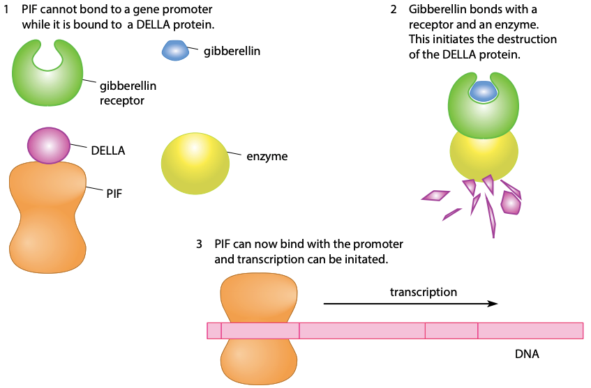

## Gene Control in Eukaryotes

* The expression of genes in eukaryotes is controlled by transcription factors (TFs)

* **Transcription factor:** A protein that controls gene expression by binding to DNA

* They bind to the promoter region of a gene, regulating its transcription by allowing, preventing, or adjusting the rate

* In humans, 10% of genes code for transcription factors

### Functions:

1) Form part of the protein complex that binds to the promoter region

2) Ensure that genes are activated in the correct sequence, which allows correct pattern for body development

3) Responsible for determination of sex in mammals

4) Allow responses to environmental stimuli e.g. activating the right genes to respond to high temperatures

5) Regulate cell cycle, growth, and apoptosis (programmed cell death)

6) Hormones (e.g. testosterone) have their effect through TFs

### Gibberellin

* The plant hormone gibberellin controls seed germination in plants, by stimulating the increase in transcription of amylase

* It does this by causing the breakdown of **DELLA proteins**, which are repressor proteins

* DELLA proteins inhibit binding of transcription factors to a gene promoter

  * TF example: **PIF** (phytochrome-interacting protein)

* When gibberellin is **absent**, the DELLA protein is attached to PIF, preventing it from binding to a gene promoter, so no transcription occurs

* When gibberellin is **present**, it binds to a receptor + enzyme to destroy the DELLA protein, allowing PIF to bind with the promoter

  * So transcription occurs and amylase is produced

