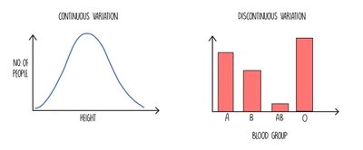

# Selection and Evolution

## Variation

* Variation refers to the differences between individuals within a species

### Genetic Variation:

* This refers to the differences between DNA sequences of individuals

* Caused by independent assortment, crossing over, random mating & fertilization, and mutation

* Mutations produce new alleles, which are often recessive

  * The mutations have no effect on the rest of the body as only one cell has it, the exception being when it causes a tumor to develop

* If mutation occurs in gametes, when they form the zygote which divides repeatedly all the cells will have the mutation, so it shows up in the phenotype

* Therefore, genetic variation can be passed on to offspring, producing phenotypic variation

### Environmental Variation:

* The environment also affects phenotype (not only genes)

* e.g. plants with the same DNA can grow both tall or short depending on environmental factors

* The environment may limit gene expression, or trigger the switching on, e.g.:

  * UV light triggering melanin production

  * Cats changing their fur color due to temperature (dark pigment at low temp)

### Phenotypic Variation:

* This refers to the differences in observable characteristics of individuals

* Results from both genetic and environmental variation

* **Discontinuous variation:** Clearly distinguishable categories with no intermediates e.g. blood type is either A, B, AB or O

  * Qualitative differences

  * Controlled by one/few genes (monogenic), so each of the alleles at one gene locus have large effects

  * Environment has little to no effect

* **Continuous variation:** A range of values e.g. height can be any within the highest and lowest values

  * Quantitative differences

  * Controlled by many genes (polygenic), so different alleles at one gene locus have small **additive** effects on phenotype

  * Environment has an effect e.g. height is affected by nutrition

* Both are affected by genes

