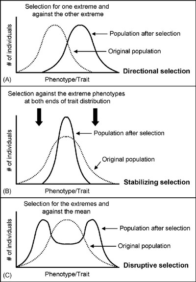

## Natural Selection

- **Natural selection:** Certain advantageous traits become more common in a population due to selection pressures

- Occurs to limit exponential growth of populations

- **Allele frequency:** The number of occurrences of alleles in a population

  - Natural selection raises advantageous allele frequencies and reduces disadvantageous allele frequencies within a population

- The 5 steps of natural selection are overproduction, variation, competition, selection, and inheritance:

1. Overproduction: Organisms produce much more offspring that can survive

2. Variation: Differences in traits exist due to genetic variation, usually caused by mutations

3. Competition: Limited resources lead to a competition to survive (struggle for existence)

4. Selection: Organisms with advantageous traits survive and reproduce

5. Inheritance: Beneficial alleles are passed down to offspring

* So, over generations, the frequency of advantageous alleles increases

* The organisms better adapted have higher **fitness** (ability to survive & reproduce)

- **Selection pressures:** Environmental factor that causes difference in survival between individuals

  - Cause changes in allele frequency which eventually leads to evolution

- **Biotic factors:** Environmental factor caused by living organisms, such as predation, pathogenic infection, or competition for food

- **Abiotic factors:** Environmental factor caused by non-living components such as water supply and light intensity

### Types of Natural Selection

1. **Stabilizing selection:**

* Favors the intermediate phenotype, while the 2 extremes are selected against

* Allele frequencies and population variety are maintained as constant over time

* e.g. Babies with average weight survive, while very low or very high weight increases infant mortality rate

2. **Directional selection:**

* Favors one extreme phenotype due to changes in environmental factors

* The other extreme is selected against, changing allele frequency gradually

* e.g. Giraffes with longer necks survive as they can reach high leaves, while the ones with short necks cannot eat so they do not survive

3. **Disruptive selection:**

* Favors both extreme phenotypes, while the intermediate is selected against

* Maintains different phenotypes within the same population (**polymorphism**)

* e.g. Birds with larger beaks can open the tough shells of large seeds, while birds with smaller beaks can delicately handle smaller seeds, so these birds survive

  * However, birds with medium sized beaks can do neither so they do not survive

### Antibiotic Resistance

* An example of **directional** selection, where bacteria with a resistance trait survive and reproduce, increasing the frequency of the resistance allele

* Can be transferred between bacteria

* Antibiotics are chemicals that inhibit or kill bacteria without affecting human tissue

1. Genetic variation exists between bacteria

2. Humans change the selection pressures on bacteria by using antibiotics

3. Some bacteria have mutations that make them resistant to antibiotics

   * e.g. in *Staphylococcus* bacteria, some have a mutation that allows them to produce **penicillinase**, an enzyme that breaks down penicillin (an antibiotic)

4. Bacteria only have a single loop of DNA with 1 copy of each gene, so any mutation is immediately expressed in the phenotype

5. The resistant bacteria survive and reproduce, passing resistance alleles to offspring

6. Over time, the resistance allele’s frequency is increased and the population becomes resistant