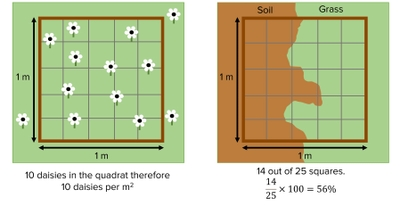
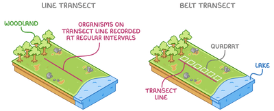

## Sampling

### Frame quadrats:

* A simple square frame, usually with a grid
* Used in random sampling when an area looks uniform or there is no clear distribution pattern of species
* For plants or slow-moving organisms

1. Use a measuring tape, or string marked every 1 meter, to create a square grid over the study area

2. Determine x and y coordinates using a random number generator, to decide and mark where the quadrats will be placed

3. Place the quadrats at the selected coordinates, and identify species using a nature guide

4. Record the species present within each square of the quadrat and measure abundance:

* Frequency: How many quadrats contain a particular species

  * e.g. if 50 quadrats were placed, and clover plants were found in 22 of them, species frequency is: 22/50 x 100 = 44%

* Density: Number of individuals per unit area

  * e.g. If a 0.5m² quadrat contains 10 daisy plants, then the density is: 10/0.5 = 20 daisy plants per m²
  * If a 1m² quadrat contains 10 daisy plants, then the density is simply 10 daisy plants per m²

* Percentage cover: How much of a quadrat is covered by a species (used when it is difficult to count individuals, or they overlap etc.)

  * e.g. If grass found in 14 out of 25 squares in a quadrat, then the percentage cover is: 14/25 x 100 = 56%

  * Use abundance scales such as the ACFOR scale or Braun-Blanquet scale

5. Repeat at multiple locations and in different seasons for more accuracy

* For safety, wear masks, gloves and other protective gear to prevent allergic reactions, insect bites etc.

### Mark-Release-Recapture:

* Used to estimate population size of mobile animals

1. Capture a sample of animals from the population using traps and bait

2. Mark each individual in a way that does not affect its survival

* e.g. tags, clip fur, waterproof paint

* Ensure the marks are non-toxic, durable, do not affect movement or behavior, and does not make them more visible to predators

3. Count the marked animals and release them back into their habitat

4. Allow enough time for them to mix randomly with the rest of the population (but not so long that migration occurs)

5. After this period recapture another large sample from the same area

6. Calculate the number of marked and unmarked individuals and estimate population size using the formula

$$
\textit{Population size} = \frac{N_1 \times N_2}{N_3}
$$

$\text{N}_1$= number of caught and marked initially

$\text{N}_2$= total number caught in $2^{\text{nd}}$ sample

$\text{N}_3$= number of marked individuals recaptured

### Simpson’s index of diversity:

* Calculates species diversity in a habitat based on abundance

$$D = 1 - \left( \sum \left( \frac{n}{N} \right)^2 \right)$$

* D (diversity index) ranges from 0-1

  * The closer the value is to 1, the higher the biodiversity so more species variation

### Line and belt transects:

* Used in systematic sampling when the area is non-uniform

  * e.g. across pollution areas or up a mountain, where abiotic factors can vary along the area

* Changes in distribution or abundance caused by these varying abiotic factors can be studied using the transects

* Example: Investigating grass species from a shaded area to a more sunlit area to study how light affects grass distribution.

* Difference between line and belt transects:

  * In **line transects**, anything that touches the line is recorded while in **belt transects**, quadrats are placed and anything within is recorded

  * Belt transects are wider, more detailed versions of line transects

* For safety, wear masks, gloves, and other protective gear to prevent allergic reactions, insect bites, etc.

**Line transects:**

1. Select a random starting point and lay out a measuring tape in a straight line along the varying study area

2. At fixed distance intervals (e.g. every 2 meters), record the species touching the tape, identifying them using a nature guide

3. Repeat at different starting points or at different times of the year and seasons

* Only the species that directly touch the tape are recorded, so line transects give presence/absence data rather than abundance

**Belt transects:**

1. Select a random starting point and lay out a measuring tape in a straight line along the varying study area

2. Place quadrats at regular intervals along the line, either end-to-end or interrupted

3. Record the presence and abundance of species within each quadrat

4. Plot the data on a set of bar charts

5. Repeat at different starting points or at different times of the year and seasons