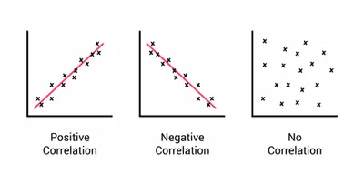

## Correlation

* Assume the null hypothesis is true: There is no correlation between the two variables

  * If in the end it is found that there is correlation between the two variables, the null hypothesis is rejected and the alternative hypothesis is accepted

* Plot a scatter graph to see if there is a correlation between 2 paired sets of data

  * Check if points lie on a straight line or are scattered

### Pearson’s linear correlation:

* Measures the linear relationship between 2 continuous variables that are normally distributed (meaning the graph is not skewed or has obvious outliers)

* Must have linear correlation

$$r = \frac{\Sigma xy - n\overline{x}\overline{y}}{ns_{x}s_{y}}$$

$n$ = sample size (number of observations)

$x$, $y$ = number of species x, number of species y

$\overline{x}\overline{,y}$= mean

$s_{x},s_{y}$ = standard deviation of x and y

* Create a table and use the formula to calculate the value of r

* The value of r is between -1 and 1, where:

  * **-1** indicates a **negative** correlation

  * **1** indicates **positive** correlation

  * **0** indicates **no correlation**

* The closer the r value is to +1, the more likely it is that there is correlation between the two sets of data

  * Example: If r = 0.79, it is closer to 1 so it indicates positive correlation

### Spearman’s rank correlation:

* Measures the relationship between 2 variables when one or both are not normally distributed

$$r_s = 1 - \left( \frac{6 \times \sum D^2}{n^3- n} \right)$$

*n =* number of pairs of items in the sample

*D =* Difference between each pair of ranked measurements

1. Rank the data set of a variable, 1 being the starting rank for the highest number and so on, then rank the other variable’s data set

* Example: If a variable has 23, 47 and 35, 47 is given rank 1, 35 is given rank 2 and 23 is given rank 3

2. Create a table for this information and then calculate the difference in rank, **D**

3. Square the difference, find the sum of D², then proceed with formula

* The closer the r’s value is to +1, the more likely it is that there is a correlation between the two sets of data