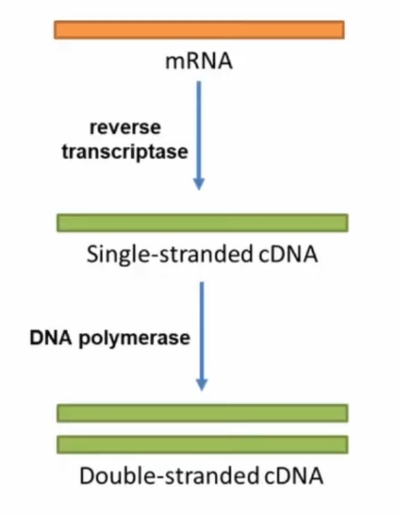
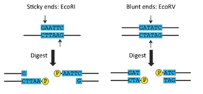
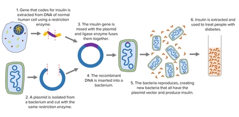

## Gene Transfer

Main example: Production of human insulin

### Step 1: Obtain the gene

* There are 3 methods:

1) Cut the gene from a chromosome using **restriction enzymes**

2) Synthesise the gene from nucleotides if the sequence is known

3) Make it from mRNA:

* Genes in DNA have **introns** (non-coding regions) that could interfere with processes, so the first method of obtaining is not preferred

  * To avoid this, mRNA is extracted and used instead, as it contains only **exons** (coding regions)

* The method of **reverse transcription** is used to synthesise DNA from the mRNA

1. mRNA is obtained from B-cells of the Islets of Langerhans, as these cells express human insulin

2. **Reverse transcriptase** is used to make **complementary DNA** (cDNA), which is single-stranded, from mRNA

3. **DNA polymerase** is used to make double-stranded cDNA from single-stranded cDNA

### Step 2: Cut target gene and plasmid DNA to produce sticky ends

* **Restriction endonucleases** (restriction enzymes) are used to cut the gene

  * There should be a restriction site on both sides of the gene, so **2** total

  * If the gene was obtained by cutting it from a chromosome (step 1), then this is already done

* Plasmids are obtained from bacteria, and it is cut at **1** restriction site using the same restriction enzyme that was used for the gene, to create complementary sticky ends

**Restriction Enzymes:**

* These are a class of enzymes that recognise, bind to, and cut DNA at restriction sites

* **Phosphodiester** bonds between nucleotides are hydrolysed

* Different kinds of restriction enzymes cut at different specific sequences

* They produce either blunt ends or sticky ends

* Sticky ends are short lengths of unpaired bases

  * They form **hydrogen** bonds with complementary base sequences on other pieces of DNA cut with the same restriction enzyme

### Step 3: Insert gene into a vector (Recombination)

* A vector can be a plasmid, which is small, circular, double-stranded DNA

* Plasmids naturally occur in bacteria, and can be artificially made in the lab

* They are cut open using a restriction enzyme to produce sticky ends

**Recombination:**

1. The opened plasmids are mixed with the lengths of DNA that have the insulin gene

2. Some sticky ends pair up, and some plasmids reform without DNA

3. **DNA ligase** links together the sugar-phosphate backbone by catalyzing the formation of phosphodiester bonds

4. A recombinant plasmid is formed

* Advantageous characteristics of plasmids:

1) Low molecular mass, so readily taken up by bacteria

2) Small, so it can be inserted into cells

3) Circular, so more stable

4) Easy to extract

5) Many copies can be present in one bacterial host cell

6) Able to replicate independently within bacteria

### Step 4: Recombinant plasmid is inserted into bacteria

1. Bacteria and plasmids are put into a solution with a high concentration of **Ca²⁺** ions and then cooled

2. The mixture is given a heat shock (**42°C**) or electric shock to increase the permeability of the bacterial cell membrane

* **1%** of the bacteria will take up the recombinant plasmids, and are said to be transformed

* The other bacteria either take up plasmids that closed without incorporating a gene, or don’t take up any at all

### Step 5: Identify transformed bacteria

* **Genetic markers** help recognize modified bacteria/transgenic organisms

* There are two that are used: GUS and GFP

1) **GUS** (B-glucuronidase enzyme)

* GUS comes from *E.coli*

* This enzyme splits a colorless substance into a product that is blue

* The bacteria with plasmids will become **blue**

2) **GFP** (green fluorescent protein)

* GFP glows **green under UV light**

* Enzymes from jellyfish make this protein

* The gene for this enzyme is inserted into the plasmids, then UV light is shone onto the bacteria to see which ones glow green

### Step 6: Grow the bacteria in fermenters

**Promoters:**

* A promoter is needed for the gene to be transcribed

* The insulin gene is inserted next to the B-galactosidase (lactase) gene so that they share a promoter

* This means that when the transformed bacteria switches on, the gene for lactase (when lactose is present), it produces both lactase and human insulin

* So to produce human insulin, the bacteria are grown in a medium containing lactose but no glucose

* The promoter is a length of DNA, with a binding site for RNA polymerase so that transcription can be initiated

  * It also ensures the correct strand is used as the template strand

### Advantages of producing human insulin using gene technology:

* In the past, diabetics were treated with insulin extracted from the pancreas of pigs or cattle

1) Identical to human insulin, so faster response & fewer side effects

2) Effective on people who have developed a tolerance to animal-derived insulin

3) Avoids ethical issues of religious beliefs and use of animal products

4) Reduced production cost as it requires less processing & purifying

5) Production facilities do not need much space, so they can be all around the world

6) A large volume of product can be produced, with a constant reliable supply year-round to keep up with increasing demand

7) Less risk of contamination & infection, with no risk of transfer of disease

8) Allows for improvements in recombinant proteins technology

* People with hemophilia need regular injections of factor VIII, which used to come from donated blood so there was a risk of infection

  * Now, GM hamster cells produce recombinant factor VIII with no such risks