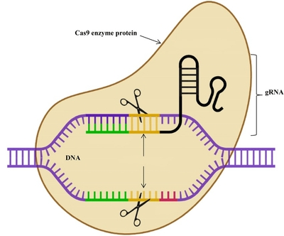

## Gene Editing

* Gene editing is changing the genome of an organism by deleting, inserting, or replacing a length of DNA

* **CRISPR**: Clustered Regularly Interspaced Short Palindromic Repeats

* Crispr is a group of base sequences that code for **guide RNA** (gRNA)

* gRNA guides **Cas9**, which is Crispr-associated protein 9 (enzyme)

1. gRNA binds to a strand of DNA with a base sequence complementary to the gRNA’s base sequence

2. Cas9 enzyme binds to the gRNA

3. Cas9 cuts both strands of DNA at a point that is determined by the gRNA, resulting in a **double-stranded break**

4. The cell’s repair mechanisms repair the break by either adding nucleotides or a short length of double-stranded DNA

* The purpose is to remove a faulty allele, or remove part of it so that it does not code for anything

* Gene editing can also be used to replace a faulty allele or part of it, so that a functioning protein is produced