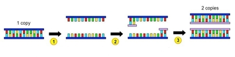

## Polymerase Chain Reaction (PCR)

* Used to clone DNA

* Components needed:

1. Template DNA

2. Heat stable DNA polymerase

3. Buffer solution, pH 7-8

4. Free deoxynucleotide triphosphate molecules **(dNTPs**)

5. 2 primers (single-stranded DNA)

### Process:

1. **Denaturation (95°C)**

* DNA strands separate (denature) into 2 strands by heating at 95°C

* This breaks the **hydrogen** bonds between base pairs

* Template strands are produced, leaving bases exposed

2. **Annealing (60-65°C)**

* Primers bind to specific base sequences with hydrogen bonds, at around 60°C

* The primer acts as a starting point for DNA polymerase, which can only bind to double-stranded DNA

* It also reduces reannealing of separated strands

3. **Extension (72°C)**

* **DNA polymeras**e binds to the primer, then uses the free dNTPs to build new DNA strands

* The new DNA strands are complementary to the template strands

The mixture is heated again to begin the second cycle

### *Taq* polymerase:

* *Taq* polymerase is a type of heat-stable DNA polymerase, from *Thermus aquaticus* bacteria found in hot springs

* It is therefore adapted to high temperatures, so it does not need to be replaced every cycle

* It has a high optimum temperature, so the temperature for the extension stage does not need to be dropped below that of the annealing stage

### Advantages of PCR:

1. Fast and efficient

2. Automated process

3. Only small samples of DNA are needed to make many copies